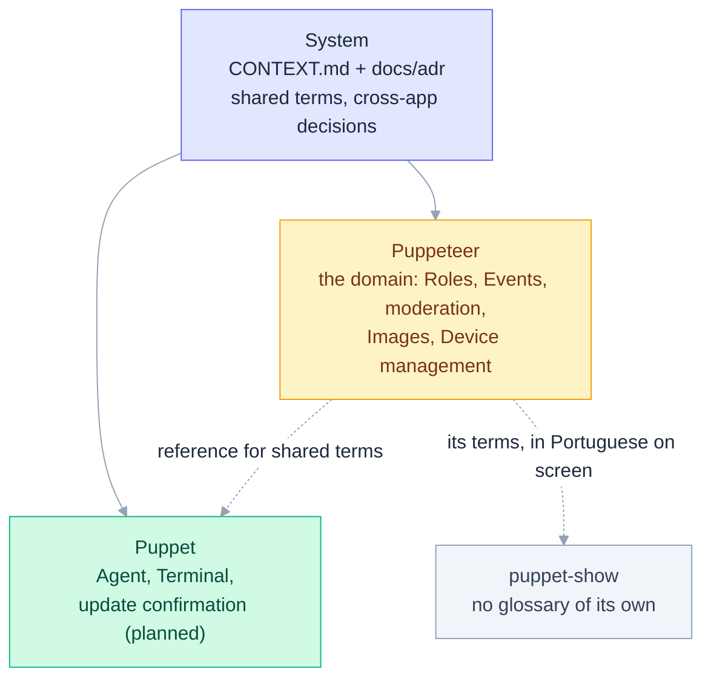

# Context Map

Event Puppeteer is a monorepo with one shared glossary and one glossary per app that owns vocabulary of its own. Read the shared one first, then the app you are working in.

| Context | Glossary | ADRs | What it owns |
|---|---|---|---|
| System | [CONTEXT.md](CONTEXT.md) | [docs/adr](docs/adr) | The terms every app shares and the decisions that span apps (the Wake-up). |
| Puppeteer | [apps/puppeteer/CONTEXT.md](apps/puppeteer/CONTEXT.md) | [apps/puppeteer/docs/adr](apps/puppeteer/docs/adr) | The domain: Organizations, Roles, Events, moderation, Images and Screening, Device management. |
| Puppet | [apps/puppet/CONTEXT.md](apps/puppet/CONTEXT.md) | [apps/puppet/docs/adr](apps/puppet/docs/adr) | The Device-side process roles (Agent, Terminal) and the planned update confirmation and Rollback. |
| puppet-show | none | none | A presentation layer: it uses Puppeteer's terms and has no vocabulary of its own. Its screens are described in [APP-DESIGN.md](apps/puppet-show/APP-DESIGN.md). |

When a term appears in more than one glossary, Puppeteer's definition is the reference. If a term is missing everywhere, add it where it belongs rather than inventing a synonym.
