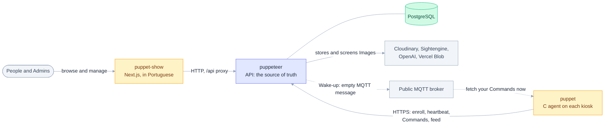

# Event Puppeteer

A system for publishing institutional events and showing them on kiosk displays (the site is called **Vem aí**). People browse and manage events on the web, an API keeps the data and the rules, and a small C agent on each kiosk keeps its feed up to date and obeys remote Commands.

The vocabulary used across the project (Puppeteer, Puppet, Device, Public Feed, Shadow Ban and others) is defined in [CONTEXT.md](CONTEXT.md); each app refines it in its own `CONTEXT.md`, listed in [CONTEXT-MAP.md](CONTEXT-MAP.md). Use those terms in code, docs and issues.

## Applications

This is a monorepo with three applications under `apps/`:

| App | What it is | Stack | Docs |
|---|---|---|---|
| [`puppeteer`](apps/puppeteer) | The server (API). Manages Organizations, Devices, Events, Users, moderation and Image screening. | TypeScript, Elysia, Drizzle (PostgreSQL), better-auth | [README](apps/puppeteer/README.md), [ADRs](apps/puppeteer/docs/adr) |
| [`puppet-show`](apps/puppet-show) | The web front end: the public Public Feed, the TV mode for kiosks and the role-based Unified Dashboard. In Portuguese. | Next.js, TanStack Query, Storybook | [README](apps/puppet-show/README.md), [screen design](apps/puppet-show/APP-DESIGN.md), [e2e](apps/puppet-show/e2e/README.md) |
| [`puppet`](apps/puppet) | The agent that runs on each kiosk Device. Enrolls with Puppeteer, waits for approval, then keeps the event feed current, sends heartbeats and Telemetry, and runs Commands. | C, CMake, libcurl, MMKV | [README](apps/puppet/README.md), [docs with diagrams](apps/puppet/docs/README.md), [ADRs](apps/puppet/docs/adr) |



puppet-show never talks to a Device directly. Both clients use the Puppeteer API, which is the single source of truth. The only other path is the **Wake-up**: when a Command is stored, Puppeteer publishes an empty message on a public MQTT broker so the Puppet fetches it at once instead of waiting for its next heartbeat. The broker carries no data and is only an accelerator, see [ADR 0001](docs/adr/0001-wake-up-over-public-mqtt-broker.md).

## Getting started

The repository uses [nub](https://www.npmjs.com/package/nub) 0.9 as its package manager and TypeScript 7.

```bash
nub install        # install the dependencies of every app
```

Then follow the README of the app you want to run:

- **puppeteer**: copy `.env.example` to `.env` and fill the variables listed in its README, then `nub run db:migrate`, `nub run db:seed:superadmin` and `nub run start`. The interactive API docs are served at `GET /openapi`.
- **puppet-show**: copy `.env.example` to `.env`, point `PUPPETEER_URL` to the API and set `NEXT_PUBLIC_ORG_ID` (create the Organization as Superadmin first), then `npm run dev`.
- **puppet**: build with CMake, giving it Puppeteer's URL at configure time (`-DPUPPET_SERVER_URL=...`). On a kiosk, install it by running `./puppet`, as described in its README.

## Tests

| App | Command |
|---|---|
| puppeteer | `nub run test` (in-memory IO, no server or external service needed) |
| puppet-show | `npm run test:unit`, `npm run test:stories`, `npm run test:e2e` (the end-to-end tests run against the real API) |
| puppet | `cmake --build build --target puppet-tests && ctest --test-dir build --output-on-failure` (pure modules; no network, Puppeteer or root) |

## Repository conventions

- Decisions are recorded as ADRs next to the app they affect (`apps/*/docs/adr`); decisions that span apps live in [docs/adr](docs/adr).
- Work is tracked in GitHub issues. See [docs/agents](docs/agents) for the issue tracker, triage labels and domain documentation conventions used by coding agents ([AGENTS.md](AGENTS.md)).
- Shared dependencies keep one version across all apps.
- The project runs on free tiers (Vercel Hobby and free plans of every external service), which is why the Wake-up uses a public broker.
- No mocks or simulated APIs in application code. If an endpoint does not exist, the interface does not offer the action.
- No silent fallbacks and no thrown errors for expected failures: errors are values, and every one is handled and shown to the user.
