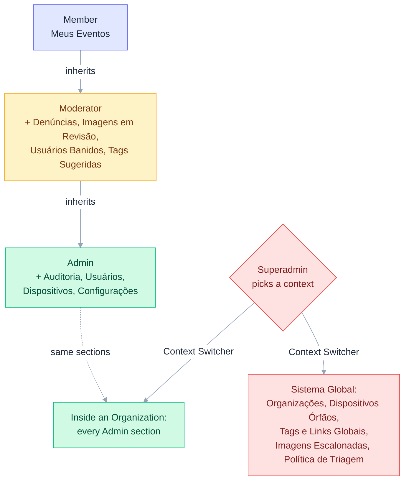
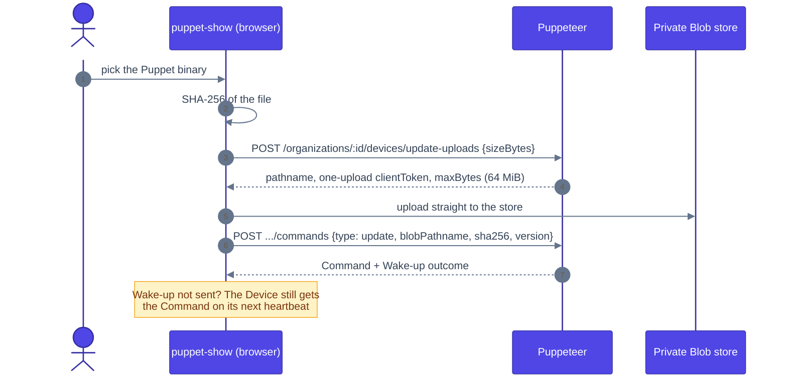

# Puppet Show: Web Client Design

This document describes the screen topology of `puppet-show` (the site is called **Vem aí** in the interface), the web front end of Puppeteer. It lists what exists today, with the real routes; the interface is in Portuguese (pt-BR). For how to run, configure and test the app, see [README.md](README.md).

Two rules shape every screen: nothing is simulated (if the API has no endpoint for an action, the screen does not offer it), and every failure is shown to the person.

## 1. One Organization per deployment

A deployment serves **one Organization**, chosen with `NEXT_PUBLIC_ORG_ID`: it is what anonymous visitors see (feed, TV mode) and where sign-ups land. There is no per-domain or per-subdomain white-label. The interface does take the Organization's primary color (`colorScheme`) and logo, and the light or dark theme is remembered per browser.

## 2. Public area and authentication

- **Public Feed, "Mural" (`/`)**: all non-hidden events of the Organization.
  - Search, and filters: Todos, Mais próximos, Mais curtidos and one pill per official Tag.
  - Event cards with date, time, place, tags and likes. Without a banner a card shows a date tile in the Organization's gradient and the start of the description instead of the photo. A like shows at once and is confirmed by the server; the feed reloads every 5 s while the tab is visible (the API has no push).
  - A QR code to the site.
- **Event details (`/eventos/[id]`)**: summary, multi-day schedule, map (OpenStreetMap), labeled external links, like, share and report (reason plus optional comment). The author can delete the event and Moderators and above can hide or unhide it.
  - Link preview: title, the Approved banner or, without one, a generated 1200×630 picture from `/eventos/[id]/capa`. Only what the public can see is exposed; anything else answers 404.
- **Publish an event (`/eventos/novo`)**: the same editor as the dashboard.
- **Sign in (`/entrar`)** and **Sign up (`/cadastro`)**: sign-up joins the configured Organization and requires confirming the email. `/login` redirects to `/entrar`, because the API's verification link lands there.
- **Confirm email (`/auth/verify-email?token=…`)**: where the verification email's link lands, on the app's own domain. The page sends the token to the API at once and says whether the email is confirmed, with a way to the login. An invalid or expired link (or one without a token) explains it and asks for the account's email to send a new link.
- **Forgot password (`/esqueci-senha`)** and **Reset password (`/redefinir-senha`)**: the link arrives by email, is valid for 1 hour, works once and ends the open sessions.

## 3. TV mode (`/display`)

A web version of the kiosk display for generic Smart TVs, laid out for 1920×1080 ("bento"). Zero touch.

- **Em exibição**: one event at a time, with its banner on the side, for 15 s plus 1 s per like. The most relevant events come back between the others.
- **Hoje**: today's events, or the next one when there are none.
- **Agenda**: the next events in calendar order, and the count of the next seven days.
- The clock and the site's QR code. The feed reloads every 30 s.

The native [`puppet`](../puppet) agent does not display events yet; this page is what a kiosk shows today.

## 4. Unified Dashboard (`/dashboard`)

One private area that discloses sections by role (Member < Moderator < Admin < Superadmin). The single rule lives in `components/dashboard/DashboardSections.ts` and mirrors the API's permissions; the layout uses it to protect every page.

Each role inherits every section of the one below. The Superadmin has no Organization: in the global context they get the global sections, and inside an Organization they get the Admin sections.

### 4.1 Member

- **Meus Eventos (`/dashboard/events`)**: events the user created, with soft deletion and status. Creating and editing happens in a side drawer in three steps (Informações; Programação; Tags, links e banner), each validated with Zod before moving on. The place is picked on an OpenStreetMap (a click sets the marker, dragging adjusts it), typed as coordinates or taken from the device's position.
  - **Banner**: picked from the device, cropped to 16:9 in the browser and uploaded once the event exists. The creator changes or removes it on the event page. Until the banner is Approved, everyone else sees its blurred Placeholder (thumbhash).

### 4.2 Moderator

- **Denúncias (`/dashboard/reports`)**: events reported by users. Actions: hide or unhide.
- **Imagens em Revisão (`/dashboard/images`)**: banners and logos Screening had doubts about or could not analyse. Pictures stay blurred until revealed; the suspected categories show first. Actions: approve, or reject (shadow-bans the uploader). Nobody sees their own Images here.
- **Usuários Banidos (`/dashboard/bans`)**: shadow-banned users (the report threshold triggers it automatically). Action: lift the ban.
- **Tags Sugeridas (`/dashboard/tags`)**: free-form tags submitted by users, to promote to the official set.

### 4.3 Admin (Organization)

- **Auditoria (`/dashboard/audit`)**: immutable log of moderation actions (who, when, what).
- **Usuários (`/dashboard/users`)**: directory of the Organization's users. Actions: change role, remove.
- **Dispositivos (`/dashboard/devices`)**: pending and enrolled Devices; approving a pending one gives it a name and location.
- **Dispositivo (`/dashboard/devices/[id]`)**: name, online badge, place and last heartbeat; hardware numbers as tiles; every other telemetry field in groups; the Command history and the logs, refreshed periodically (a failed refresh keeps the last data with the error above it).
  - **Commands**: Reiniciar and Desligar (both ask for confirmation), Pedir telemetria, and Atualizar Puppet. The update form takes the binary, computes its SHA-256, uploads it straight to the private store and then sends the `update` Command (up to 64 MiB).
  - **Wake-up**: issuing a Command shows whether its Wake-up was published, and a pending or sent Command can have it sent again. A failed Wake-up does not lose the Command: the Device gets it on its next heartbeat.
  - **Update upload**: the binary never passes through Puppeteer, which only authorizes the upload and signs the download.

- **Configurações (`/dashboard/settings`)**: the Organization's data, color, Shadow Ban report threshold and logo (uploaded and cropped square).

### 4.4 Superadmin (global context)

Reached through the **Context Switcher** at the top of the menu, which toggles between "Sistema Global" and a specific Organization (the choice is remembered). Inside an Organization the Superadmin has every Admin section.

- **Organizações (`/dashboard/global/orgs`)**: create and configure Organizations.
- **Dispositivos Órfãos (`/dashboard/global/devices`)**: Devices that enrolled without an Organization. Action: approve into one (the Puppet never sends an Organization today, so every new Device lands here).
- **Tags Globais (`/dashboard/global/tags`)** and **Links Globais (`/dashboard/global/links`)**: the official Tags and Link Labels.
- **Imagens Escalonadas (`/dashboard/global/images`)**: Image Review for Images only Superadmins can decide.
- **Política de Triagem (`/dashboard/global/screening`)**: per-category cut-offs, in percent, deciding whether Screening approves an Image, sends it to Image Review or rejects it.

## 5. Accessibility

Every screen works at 390 px (phones) without horizontal scroll and by keyboard. Components have Storybook stories that run as tests with axe accessibility checks, and the end-to-end tests check the mobile viewport for horizontal scroll.
