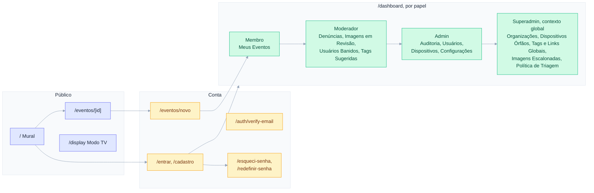
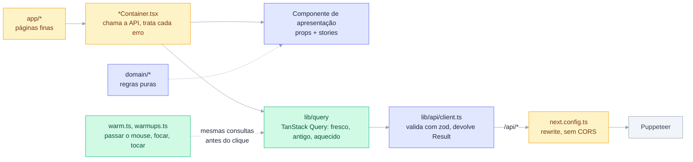

<h1 align="center">puppet-show</h1>

<p align="center">
  Front-end do mural de eventos: o <strong>Mural</strong> público, onde qualquer pessoa da organização encontra, curte, compartilha e denuncia eventos; o <strong>Modo TV</strong> para os totens; e o <strong>Painel</strong>, que mostra a cada papel (Membro, Moderador, Admin, Superadmin) as ferramentas que ele pode usar.
</p>

O site se chama **Vem aí** na interface. Todos os dados vêm da API **Puppeteer** (`apps/puppeteer`); o front nunca fala com um dispositivo. O vocabulário do domínio está em [`CONTEXT.md`](../../CONTEXT.md) (e no [`CONTEXT.md` do Puppeteer](../puppeteer/CONTEXT.md)), o desenho das telas em [`APP-DESIGN.md`](APP-DESIGN.md) e a especificação na issue #1 do GitHub.

## Telas

| Rota | O que faz |
|---|---|
| `/` | Mural: busca, filtros (Todos, Mais próximos, Mais curtidos e uma pílula por tag oficial), cards com data, horário, local, tags e curtidas (sem banner, o card troca a foto por um bloco de data no degradê da organização e mostra o começo da descrição). O mural é recarregado a cada 5 s enquanto a aba está visível (a API não tem push), e a curtida aparece na hora e é confirmada pelo servidor. |
| `/eventos/[id]` | Detalhes: programação de vários dias, mapa (OpenStreetMap), links (ex.: Inscrição), curtir, compartilhar, denunciar; o autor pode excluir e Moderadores+ podem ocultar ou reexibir. A página traz a prévia de link do evento (título, banner aprovado ou, sem banner, a imagem gerada em `/eventos/[id]/capa`, 1200×630). |
| `/eventos/novo` | Publicar evento: o mesmo editor do painel, em três etapas. O local se escolhe num mapa do OpenStreetMap (clique para pôr o marcador, arraste para ajustar), ou digitando as coordenadas, ou pela posição do dispositivo. |
| `/display` | Modo TV, em layout "bento" de 1920×1080: um evento em destaque por vez, com o banner ao lado, por 15 s mais 1 s por curtida (os mais relevantes voltam entre os outros); "Hoje", a agenda dos próximos eventos, a contagem dos próximos sete dias e o QR code para o site. O feed é recarregado a cada 30 s. |
| `/entrar`, `/cadastro` | Login e cadastro com confirmação de e-mail. |
| `/auth/verify-email` | Destino do link do e-mail de confirmação: envia o token à API (`POST /auth/verify-email`), diz se o e-mail foi confirmado e, se o link for inválido ou tiver expirado, pede o e-mail da conta para enviar um novo. |
| `/esqueci-senha`, `/redefinir-senha` | Esqueci minha senha: a pessoa recebe por e-mail um link (válido por 1 hora, uso único) para escolher uma nova senha; as sessões abertas são encerradas. |
| `/dashboard/...` | Painel: Meus Eventos; Denúncias, Imagens em Revisão, Usuários Banidos e Tags Sugeridas (Moderador+); Auditoria, Usuários, Dispositivos e Configurações, onde fica o logo (Admin+); Organizações, Dispositivos Órfãos, Tags e Links Globais, Imagens Escalonadas e Política de Triagem (Superadmin no contexto "Sistema Global"). O Superadmin troca de contexto pelo seletor no topo do menu, e a escolha fica salva. Em Dispositivos, o Admin aprova dispositivos pendentes (nome e local), vê telemetria e logs e envia comandos (reiniciar, desligar, pedir telemetria e atualizar o Puppet com o envio do binário de até 64 MiB, conferido por SHA-256); o resultado do Wake-up aparece ao emitir o comando e pode ser reenviado enquanto o comando não foi reconhecido. |



## Configuração

Copie `.env.example` para `.env` e preencha:

| Variável | Obrigatória | Para quê |
|---|---|---|
| `PUPPETEER_URL` | sim | URL da API. O Next encaminha `/api/*` para ela (sem CORS). Sem ela o app não inicia. |
| `NEXT_PUBLIC_ORG_ID` | sim | Organização que visitantes veem (mural, Modo TV) e na qual os cadastros entram. |
| `NEXT_PUBLIC_SITE_URL` | sim | Endereço público do site, usado só na prévia de link dos eventos (`og:url`); sem ele a prévia fica sem o endereço e a falha é registrada. O QR Code não depende dele: usa o endereço de onde o app está sendo servido (`x-forwarded-host`/`host`), lido a cada requisição. |

O Next encaminha `/api/*` para `PUPPETEER_URL` (`next.config.ts`) e redireciona `/login` para `/entrar`, porque o link de confirmação de e-mail da API cai em `/login`. Na Vercel, `PUPPETEER_URL` é o endereço da implantação da API.

## Comandos

Dependências com `nub install` na raiz do repositório.

```bash
npm run dev            # next dev
npm run storybook      # Storybook em http://localhost:6006 (inclui o servidor MCP)
npm run test:unit      # funções puras e o teste de contrato com a API (Vitest, Node)
npm run test:stories   # cada story é um teste de componente + acessibilidade (axe), no Chromium
npm run test:e2e       # fluxos completos contra a API real; veja e2e/README.md
npx tsc --noEmit -p . && npx tsc --noEmit -p e2e   # typecheck do app (com stories) e dos testes E2E
npm run lint
```

## Organização do código

Como um dado chega à tela: o componente de apresentação só recebe props; o *container* lê o cache, e o cache fala com a API pelo proxy do Next, sem CORS. Nenhuma etapa lança exceção: o retorno é sempre um `Result`.



- `app/`: as rotas (App Router). Páginas finas que montam os *containers*; `app/eventos/[id]/capa/route.tsx` gera a imagem de prévia de um evento sem banner.
- `contract/`: confere a cópia dos schemas (`lib/api/schemas.ts`) com os schemas do próprio Puppeteer, para que um valor novo da API não derrube uma página (issue #15 propõe gerar a cópia). Fica fora do `tsconfig` do app, como `e2e/`.
- `lib/api/`: o contrato da API (`schemas.ts`, em zod; os tipos do app são inferidos dele) e o cliente HTTP (`client.ts`). Toda resposta é validada, e nenhuma chamada lança exceção: o retorno é um `Result` (`lib/result.ts`) e `ApiErrorMessage` transforma a falha em texto para a pessoa.
- `lib/query/`: o cache de dados compartilhado (TanStack Query). Toda leitura da API passa por ele, então os dados sobrevivem à troca de página: a tela mostra o que já está no cache na hora e atualiza em segundo plano. `queries.ts` tem as leituras (sessão, tags, organização, feed, evento...), `options.ts` define quanto tempo cada resposta é "fresca" (`Freshness`) e o formato `Answer` (um erro carrega o último dado bom, para uma atualização que falha não esvaziar a tela), e `loaded.ts`/`useLoaded.ts` fazem o mesmo para as listas do painel, que já nascem como `Result<T, string>`. As funções de consulta nunca lançam exceção. Login e logout descartam o cache da sessão anterior. `warm.ts` e `warmups.ts` carregam dados antes do clique (ao passar o mouse, focar ou tocar num link do painel, do menu ou de um evento), com as mesmas consultas da página; `components/dashboard/sectionWarmups.ts` diz o que cada seção do painel lê.
- `lib/theme/`: tema claro/escuro e a cor da organização, lembrados por navegador e aplicados antes da primeira pintura.
- `hooks/`: sessão (`useAuth`) e o feed de eventos (`useEvents`, atualizado a cada 5 s).
- `domain/`: regras puras do mural (filtros, programação, curtidas, links, tempo da TV), com testes unitários.
- `components/`: componentes de apresentação (recebem dados por props e têm stories) e *containers* (`*Container.tsx`), que chamam a API e tratam cada erro. `components/ui/` tem os blocos compartilhados (mensagens de erro e status, `Drawer` e `ConfirmDialog` sobre o `<dialog>` nativo).
- `components/dashboard/DashboardSections.ts`: a regra única de quais seções cada papel vê em cada contexto (espelha as permissões da API). O layout do painel usa essa regra para proteger todas as páginas.
- `utils/validation/`: validações dos formulários, com testes.

## Convenções

- Sem mocks nem APIs simuladas no código do app; se um endpoint não existe, a interface não oferece a ação.
- Sem fallbacks silenciosos: configuração ausente ou dado inválido aparece como erro explícito.
- Erros como valores (`Result`); toda falha é mostrada para a pessoa.
- Sem `any`. Comentários só como documentação JSDoc.
- Todas as telas funcionam em 390 px (celular) sem rolagem horizontal e por teclado.

## Extensões recomendadas para IDE

- ESLint (Microsoft)
- Tailwind CSS IntelliSense (Tailwind Labs)
- Color Info (Matt Bierner)
- TypeScript 7 (Microsoft)
