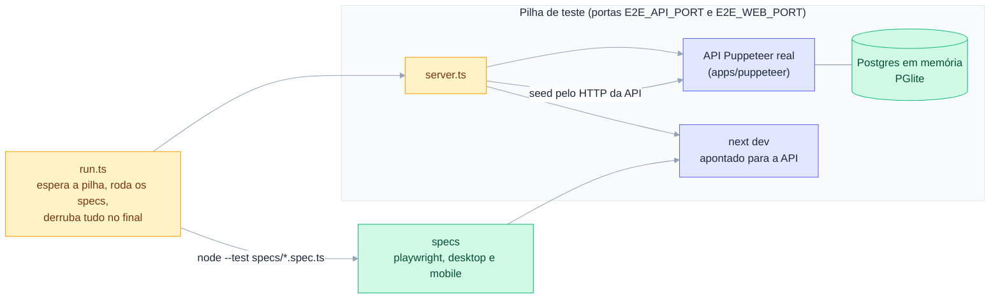

# Testes end-to-end

Fluxos reais do puppet-show contra a **API Puppeteer real**, sem nada simulado:

- `server.ts` sobe a API (`apps/puppeteer`) com banco Postgres em memória (PGlite) e better-auth de verdade, faz o seed pelo próprio HTTP da API e depois inicia `next dev` apontado para ela.
- `run.ts` espera a API e o front responderem, roda todos os `specs/*.spec.ts` com `node --test` e derruba a pilha no final.
- Os specs usam a biblioteca `playwright` (sem `@playwright/test`) e os helpers de `support.ts`.



## Rodar

```bash
cd apps/puppet-show
npm run test:e2e                                         # suíte inteira (~10 min)
npm run test:e2e -- --test-name-pattern="Público"        # só um grupo (describe)
E2E_API_PORT=8110 E2E_WEB_PORT=3110 npm run test:e2e     # outras portas (várias pilhas em paralelo)
```

Pré-requisitos: dependências instaladas com `nub install` e o Chromium da versão do Playwright em uso (`npx playwright install chromium`). Se aparecer `Executable doesn't exist at .../chromium_headless_shell-XXXX`, a versão do Playwright mudou e o navegador correspondente precisa ser instalado.

## Dados semeados

| Conta (senha `password123`) | Papel |
|---|---|
| `super@e2e.test` | Superadmin |
| `admin@e2e.test` | Admin da "Universidade Estadual" (orgA, organização pública) |
| `moderador@e2e.test` | Moderador da orgA |
| `membro@e2e.test`, `relator@e2e.test` | Membros da orgA |
| `outro@e2e.test` | Membro da "Outra Organização" (orgB) |

Além disso: tags Tecnologia/Cultura (oficiais) e robotica (livre); rótulo de link Inscrição; eventos nas duas organizações (um com dois dias, tag, link, voto e denúncia); um dispositivo órfão, um pendente na orgA e um ativo na orgA com telemetria. A política de triagem vale 30% (revisão) / 80% (recusa) em todas as categorias e a análise automática do teste responde violência 50%, então toda imagem enviada aguarda revisão; as imagens guardadas são servidas em `/__e2e/images/<id>.webp`. Os ids ficam em `/__e2e/state` (e em `.state.json`); os e-mails "enviados" em `/__e2e/emails`.

## Escrevendo specs

- Um arquivo por área (`public-*`, `dashboard-shell-*`, `dashboard-admin-*`) e um `describe` com nome em português que permita filtrar.
- Teste nos dois viewports (`OpenPage("desktop")` e `OpenPage("mobile")`) e verifique `HasHorizontalScroll` no celular.
- Afirme que a página não registrou erros (`errors` de `OpenPage`). Quando o teste provoca um erro de propósito (um 409 ou 400), declare exatamente qual é esperado.
- Os specs compartilham o mesmo seed: para alterar ou excluir algo, crie seus próprios dados com `Api(...)` / `CreateEvent(...)` e restaure o que mudar no seed.
