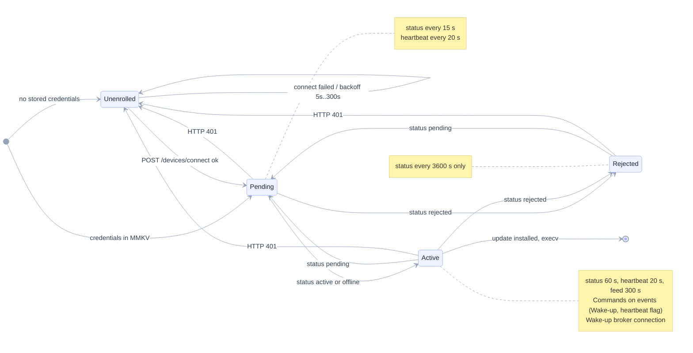
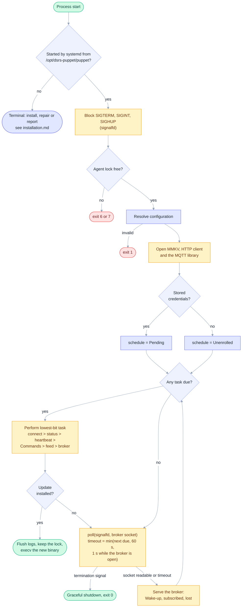
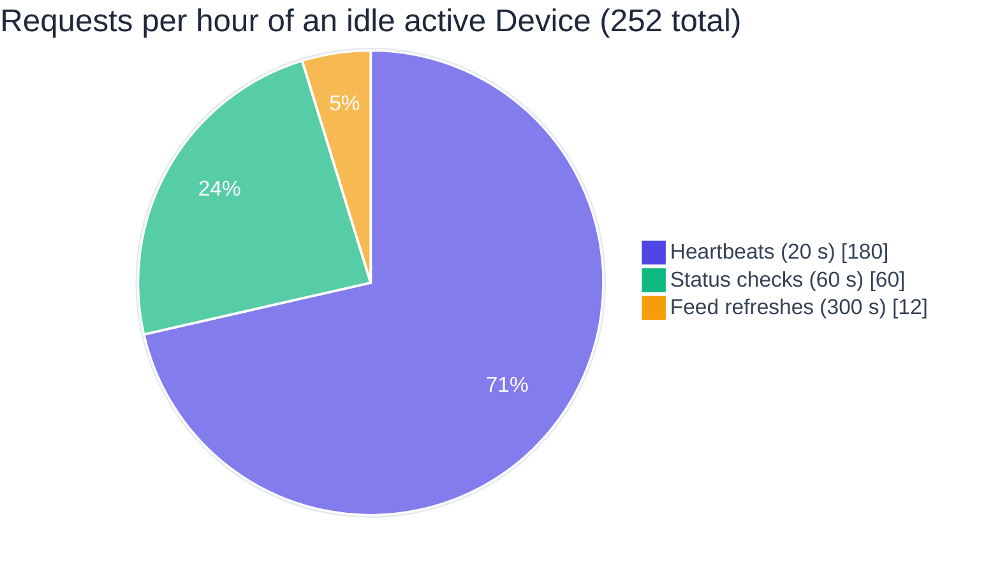
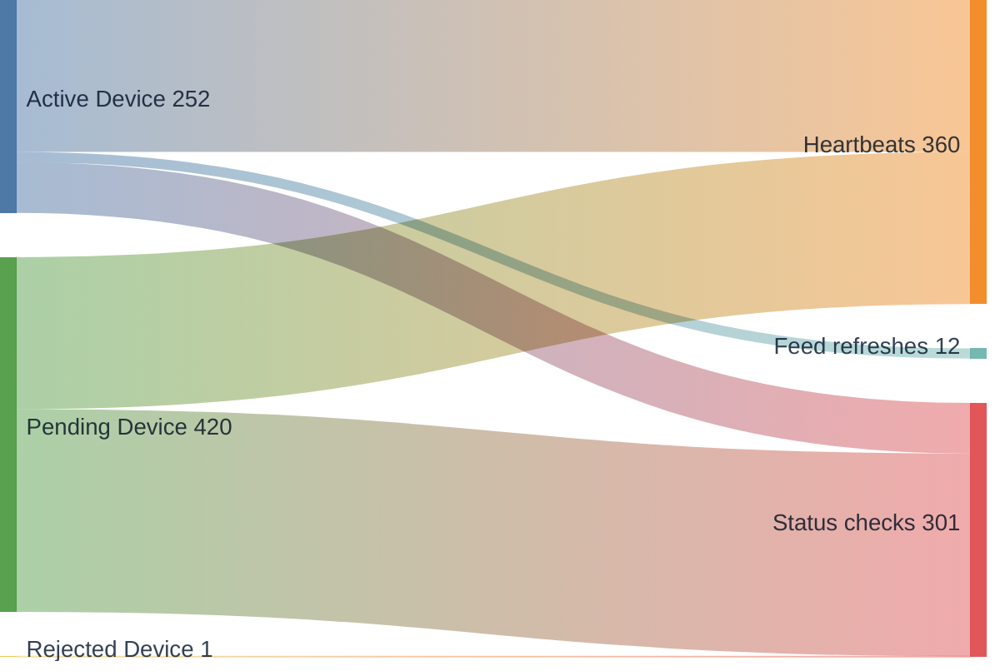
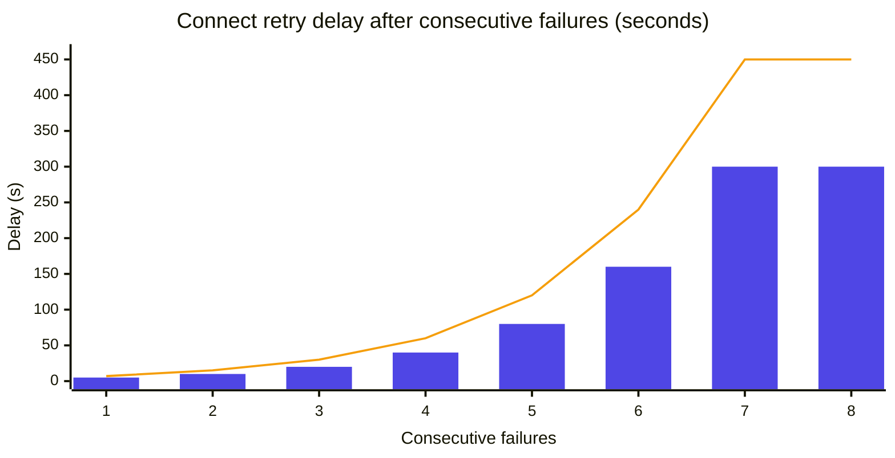
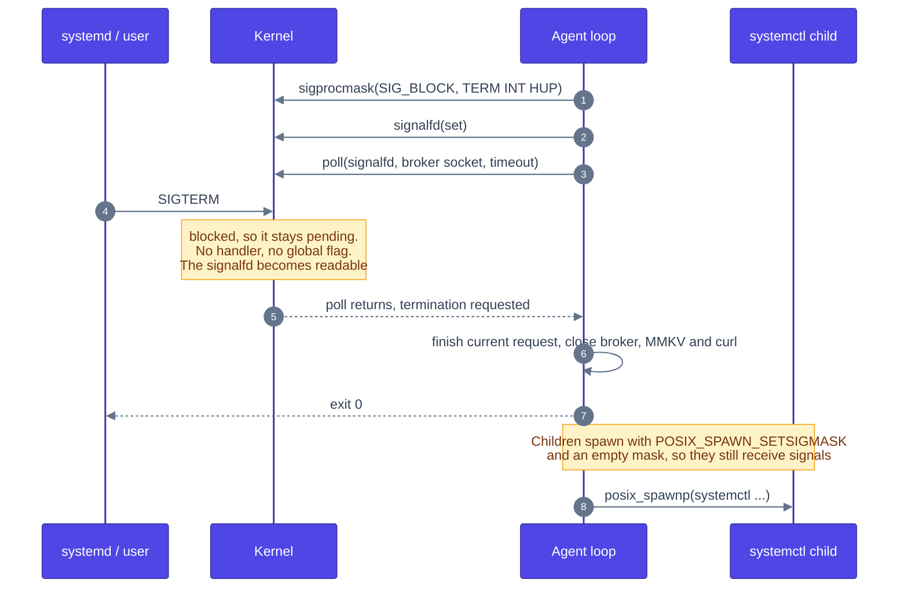
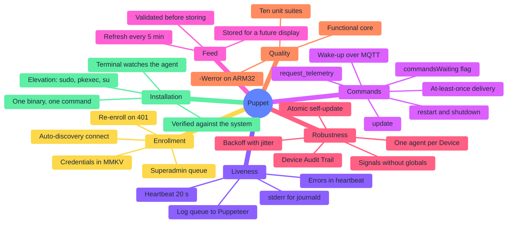

# Agent loop and scheduling

The agent is the Puppet process systemd starts. It is a single-threaded loop: a pure state machine (`agent-schedule`) decides which task is due, the loop performs it and feeds the outcome back, and between tasks it waits on a termination signal and on the Wake-up broker's socket at once.

## Contents

- [Phases](#phases)
- [Main loop](#main-loop)
- [Cadence of an active Device](#cadence-of-an-active-device)
- [Request mix](#request-mix)
- [Request volume by phase](#request-volume-by-phase)
- [Connect backoff](#connect-backoff)
- [Termination without global state](#termination-without-global-state)
- [Capabilities at a glance](#capabilities-at-a-glance)

## Phases

Waiting in Pending is a normal, indefinite state (ADR-0002). Puppeteer's answer to each status check decides the phase, so an approval, a rejection or a reset takes effect on the next check. A 401 at any point sends the Puppet back to enrollment.

## Main loop

When several tasks are due, the lowest bit wins: connect, then status, heartbeat, Commands, feed and the broker tasks. Termination is noticed at every wait. The Terminal role (any run not started by systemd) never reaches this loop; see [Installation](installation.md).

## Cadence of an active Device

Intervals after approval: status 60 s, heartbeat 20 s (Puppeteer marks a Device offline after 60 s of silence), feed 300 s. Commands have no timer: they are fetched when the Device becomes active, whenever a heartbeat answer says some are waiting, whenever a Wake-up is heard and after every (re)subscription to the broker ([Wake-ups](wakeup.md)).

```mermaid
%%{init: {'theme': 'base', 'themeVariables': {
  'primaryColor': '#e0e7ff', 'primaryTextColor': '#1e293b',
  'primaryBorderColor': '#6366f1', 'lineColor': '#94a3b8',
  'secondaryColor': '#d1fae5', 'tertiaryColor': '#fef3c7',
  'background': '#ffffff', 'mainBkg': '#eef2ff', 'nodeBorder': '#a5b4fc',
  'clusterBkg': '#f8fafc', 'clusterBorder': '#e2e8f0',
  'titleColor': '#1e293b', 'edgeLabelBackground': '#ffffff', 'textColor': '#334155'
}}}%%
gantt
    title First two minutes after approval (idle, no Commands)
    dateFormat HH:mm:ss
    axisFormat %M:%S
    tickInterval 20second
    section Status (60 s)
        check :milestone, s0, 00:00:00, 0s
        check :milestone, s1, 00:01:00, 0s
        check :milestone, s2, 00:02:00, 0s
    section Heartbeat (20 s)
        beat :milestone, h0, 00:00:00, 0s
        beat :milestone, h1, 00:00:20, 0s
        beat :milestone, h2, 00:00:40, 0s
        beat :milestone, h3, 00:01:00, 0s
        beat :milestone, h4, 00:01:20, 0s
        beat :milestone, h5, 00:01:40, 0s
        beat :milestone, h6, 00:02:00, 0s
    section Commands (events)
        fetch on becoming active :milestone, c0, 00:00:00, 0s
        fetch after subscribing :milestone, c1, 00:00:02, 0s
        nothing to poll :active, c2, 00:00:02, 118s
    section Feed (300 s)
        refresh :milestone, f1, 00:00:00, 0s
        next refresh at 5 min :f2, 00:00:00, 120s
    section Wake-up broker
        connect and subscribe :milestone, b0, 00:00:00, 0s
        listening :active, b1, 00:00:02, 118s
```

## Request mix

An idle active Device makes about 252 small requests per hour, down from about 612 when it also polled Commands every 10 s. The MQTT connection is not a Puppeteer request.

## Request volume by phase

Requests per hour for an idle Device in each phase.

## Connect backoff

Failed connects back off exponentially from 5 s up to a 300 s cap (bars). Up to 50% random jitter is added so a fleet does not reconnect in lockstep after an outage (line: worst case).

## Termination without global state

Signals are blocked and collected through a `signalfd`, so there is no signal handler and no mutable global flag; in-flight requests always finish. One `poll` waits for the signal and the broker socket together.

## Capabilities at a glance

Everything the Puppet does, grouped by concern.

