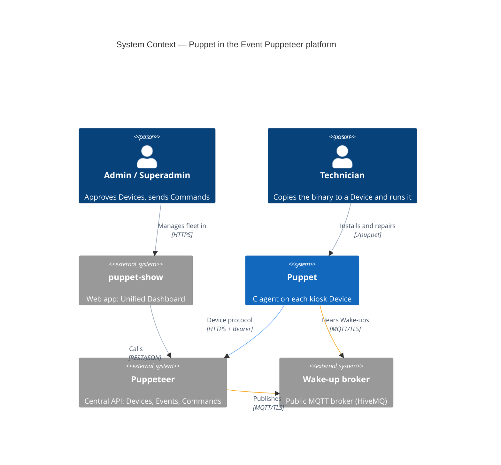
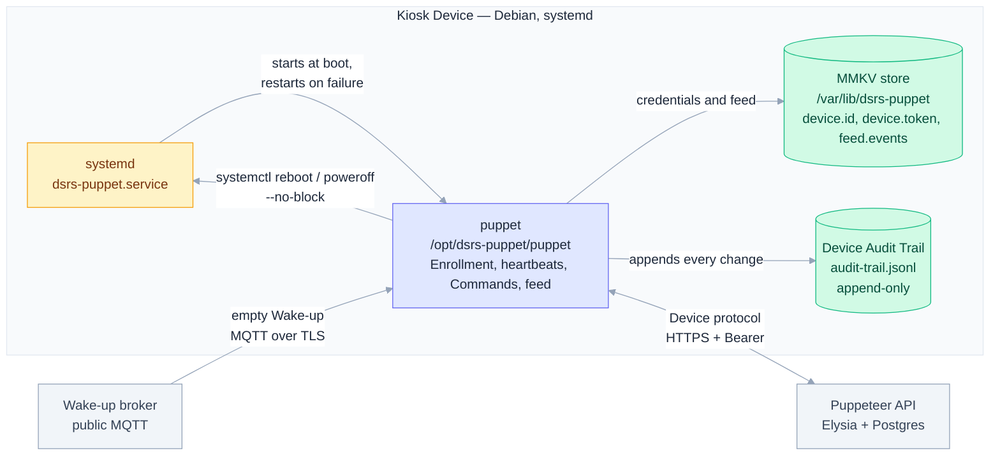
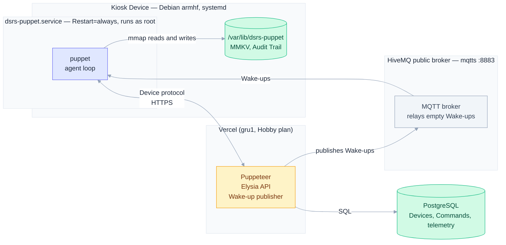
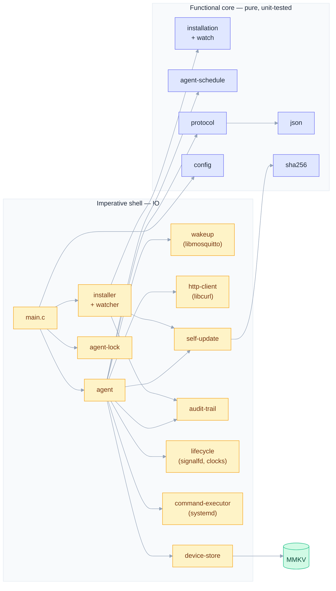
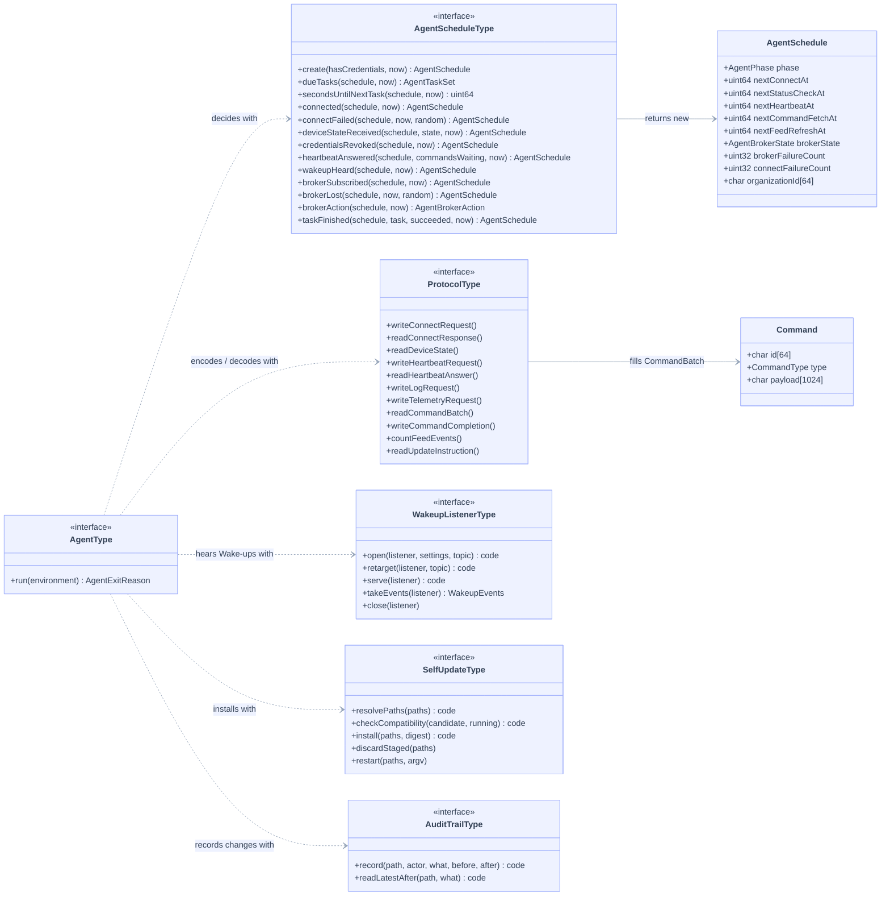
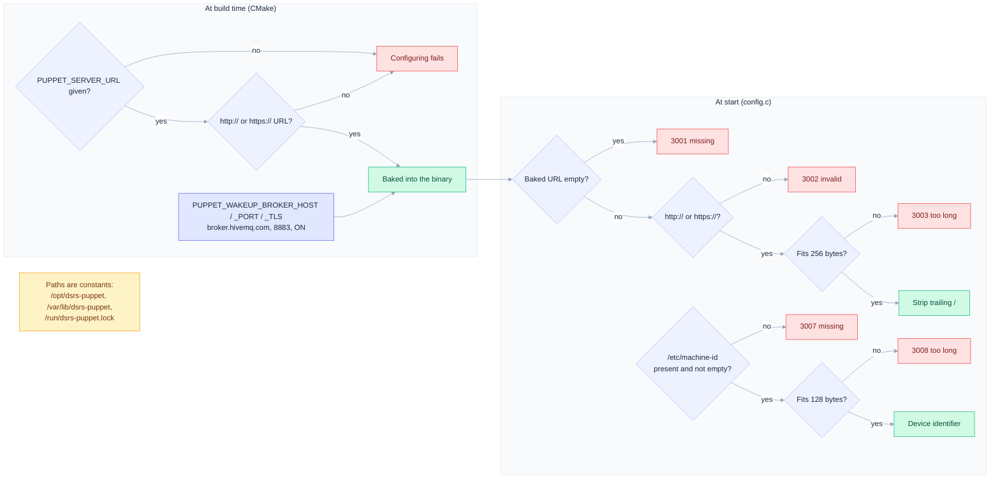
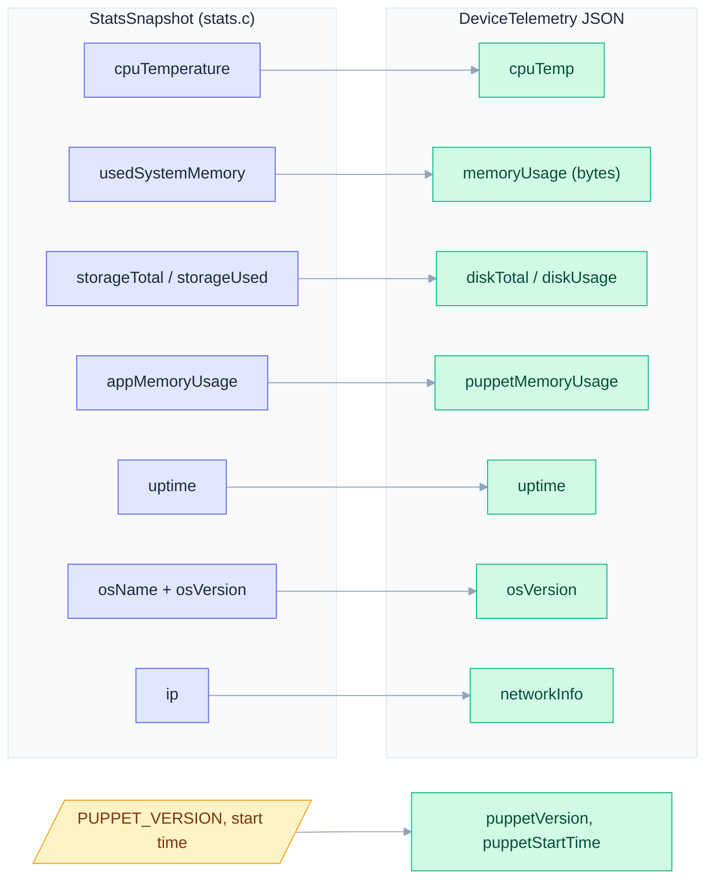
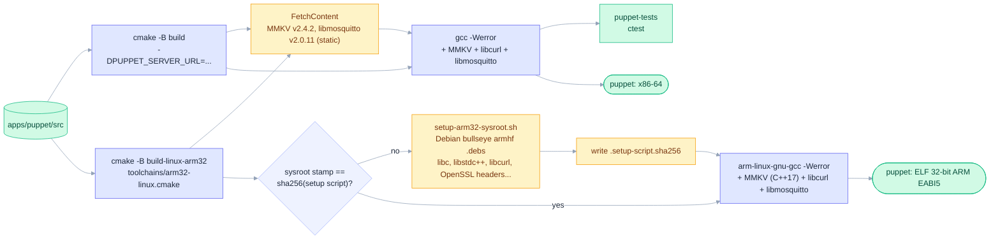

# Architecture

How Puppet fits into the Event Puppeteer platform, how it is installed and deployed, and how its C modules are organized around a functional core and an imperative shell.

## Contents

- [System context](#system-context)
- [What runs on a Device](#what-runs-on-a-device)
- [Deployment](#deployment)
- [Module dependencies](#module-dependencies)
- [Module interfaces](#module-interfaces)
- [Configuration resolution](#configuration-resolution)
- [Telemetry mapping](#telemetry-mapping)
- [Build pipeline](#build-pipeline)

## System context

Puppet is the agent running on every kiosk Device. It talks to Puppeteer over HTTPS and listens to a public MQTT broker for Wake-ups, empty notices that make it fetch a waiting Command at once. Admins act on Devices through puppet-show, never directly. A technician puts the binary on the Device and runs it once. Displaying the feed on screen is not implemented yet.

## What runs on a Device

A single `puppet` binary installed at `/opt/dsrs-puppet/puppet`, started by systemd as root. Its data directory holds the MMKV store and the append-only Audit Trail; systemd also executes the power Commands.

## Deployment

Kiosks run Debian (ARM32 builds target bullseye) under a systemd service; Puppeteer runs on Vercel backed by PostgreSQL. The broker is a public one, so it is outside both.

## Module dependencies

Pure modules (blue) hold every decision and are unit-tested without network, clock, filesystem or root. Shell modules (amber) perform IO and stay thin.

## Module interfaces

Each module exposes a single `const struct <Type>Type <Type>I` of function pointers (see [coding standards](coding-standards.md)). The agent composes them.

## Configuration resolution

Puppet reads no environment variable for configuration (ADR-0001). Puppeteer's URL and the broker are chosen when building; paths are constants; the Device identifier is always `/etc/machine-id`. Every failure path has its own error code (3001–3003, 3007–3008).

## Telemetry mapping

How the `stats` snapshot becomes the `DeviceTelemetry` JSON answered to a `request_telemetry` Command. Empty strings are omitted so they never overwrite a previous report.

## Build pipeline

Native builds run the unit tests. ARM32 cross builds fetch a Debian sysroot, re-fetched automatically whenever the setup script changes. libmosquitto is built from source and linked statically, so a Device needs only the libcurl runtime.

