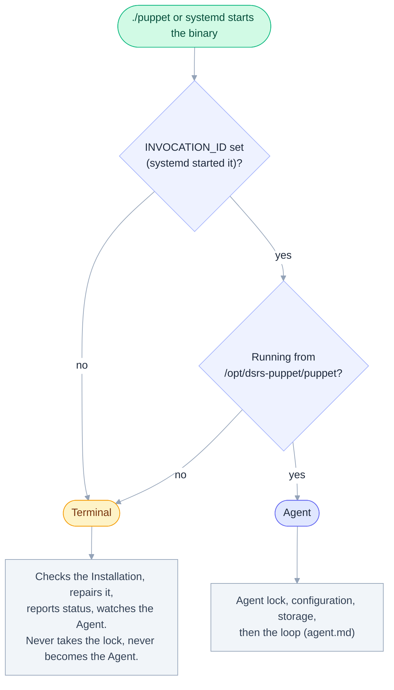
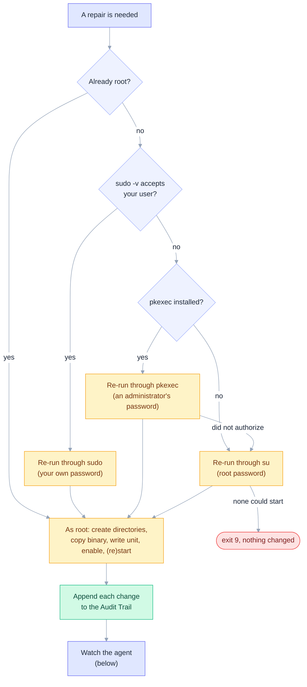
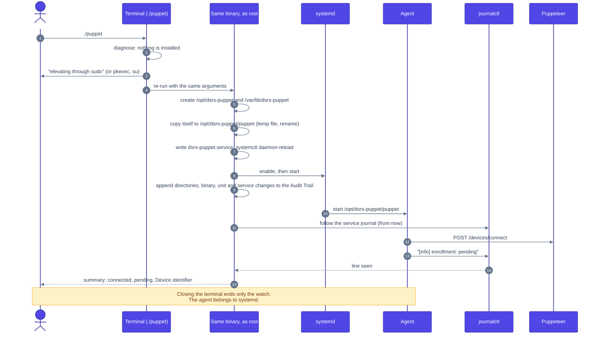
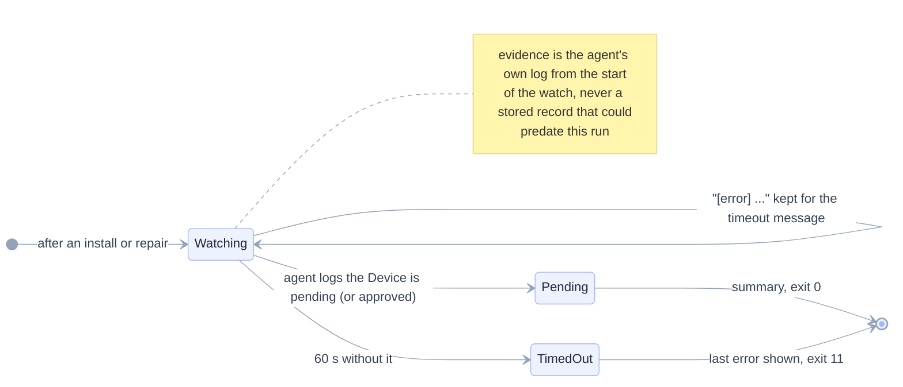
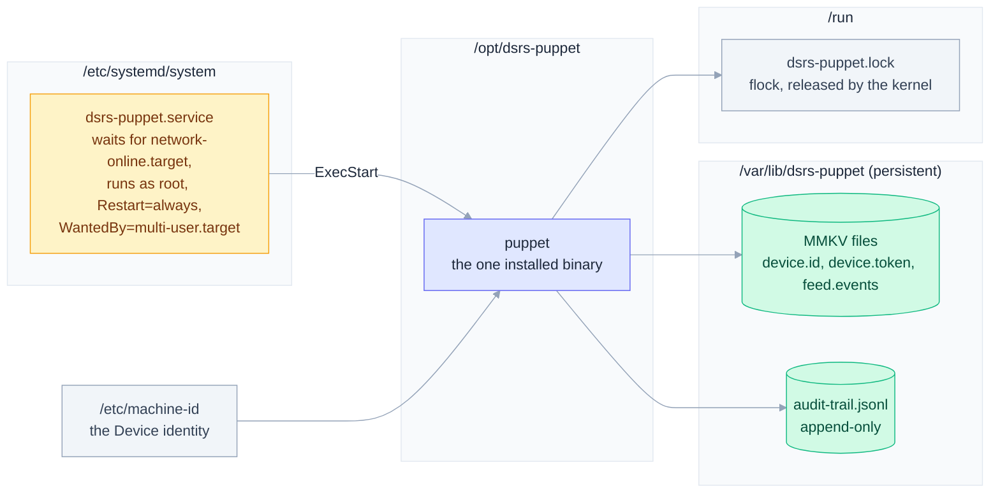
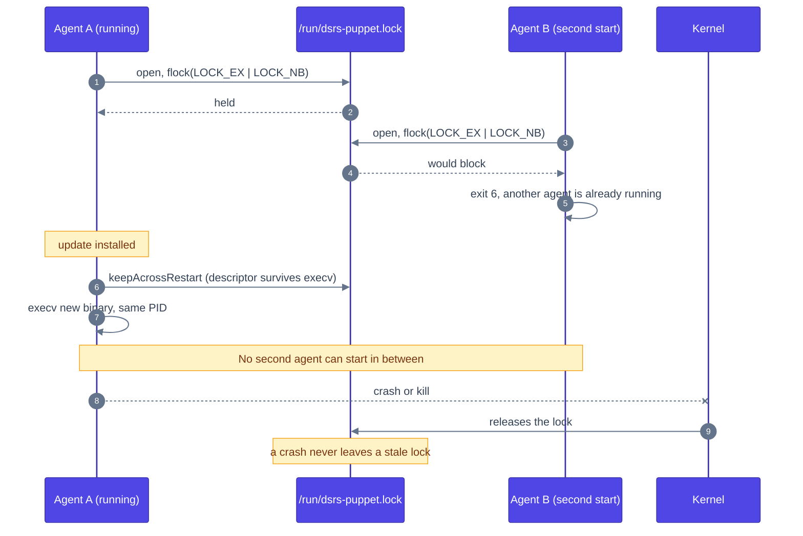
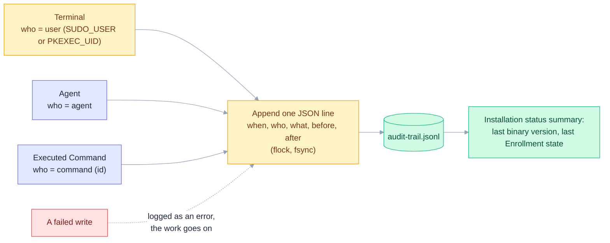

# Installation

How a technician puts the Puppet on a Device with one binary and one command, how it repairs itself, and the files it leaves behind. The decision is in [ADR-0001](adr/0001-self-installing-binary-configured-at-compile-time.md); what each run checks and repairs is in the [README](../README.md#running-the-application-the-installation).

## Contents

- [Step by step](#step-by-step)
- [Two roles, one binary](#two-roles-one-binary)
- [What is checked](#what-is-checked)
- [Elevation and repair](#elevation-and-repair)
- [A fresh Installation](#a-fresh-installation)
- [Watching the agent](#watching-the-agent)
- [Where things live](#where-things-live)
- [Only one agent](#only-one-agent)
- [Device Audit Trail](#device-audit-trail)

## Step by step

Installing a Puppet on a kiosk from the published binary. Nothing is compiled: the release already holds a build for 32-bit ARM.

```mermaid
%%{init: {'theme': 'base', 'themeVariables': {
  'primaryColor': '#e0e7ff', 'primaryTextColor': '#1e293b',
  'primaryBorderColor': '#6366f1', 'lineColor': '#94a3b8',
  'secondaryColor': '#d1fae5', 'tertiaryColor': '#fef3c7',
  'background': '#ffffff', 'mainBkg': '#eef2ff', 'nodeBorder': '#a5b4fc',
  'clusterBkg': '#f8fafc', 'clusterBorder': '#e2e8f0',
  'titleColor': '#1e293b', 'edgeLabelBackground': '#ffffff', 'textColor': '#334155'
}}}%%
flowchart LR
    subgraph technician["Technician, on the Device"]
        direction TB
        s1["1. Check the Device"]:::shell --> s2["2. Get the binary<br/>from the release"]:::shell
        s2 --> s3["3. chmod +x and run ./puppet"]:::shell
        s3 --> s4["4. Type the password,<br/>read the summary"]:::shell
    end
    subgraph admin["Superadmin, in puppet-show"]
        direction TB
        s5["5. Approve the Device<br/>in Dispositivos Órfãos"]:::core
    end
    subgraph check["Either"]
        direction TB
        s6["6. Confirm it is active"]:::ok
    end
    s4 -->|"Device is pending"| s5
    s5 -->|"within 15 s"| s6
    s3 -.->|"exit 9, 10 or 11"| fix["See Troubleshooting"]:::danger
    classDef core fill:#e0e7ff,stroke:#6366f1,color:#1e293b
    classDef shell fill:#fef3c7,stroke:#f59e0b,color:#78350f
    classDef ok fill:#d1fae5,stroke:#10b981,color:#064e3b
    classDef danger fill:#fee2e2,stroke:#ef4444,color:#7f1d1d
```



### 1. Check the Device

- 32-bit ARM (`uname -m` prints `armv7l`) running **Debian 11 (bullseye)** with systemd. The release is built against bullseye and needs its `libssl.so.1.1`, which newer Debian releases (OpenSSL 3) no longer ship; for those, build your own ([README](../README.md#native-build-instructions)).
- The libcurl runtime: `sudo apt install libcurl4` (it brings libssl). Nothing else: libmosquitto is part of the binary.
- Network access to Puppeteer over HTTPS, and to the Wake-up broker (`broker.hivemq.com`, port 8883) for instant Commands. Without the broker the Device still works, with up to 20 s of delay.
- `/etc/machine-id` present: it is the Device's identity. Cloning an SD card without regenerating it makes two Devices look like one.
- Persistent storage for `/var/lib`: losing it makes the Device enroll again as a new pending Device.
- Someone who can become root: a user `sudo` accepts, an administrator reachable through `pkexec`, or the root password for `su`.

### 2. Get the binary

The builds are attached to the GitHub release [`puppet-0.0.1`](https://github.com/joaorochajr/event-puppeteer/releases/tag/puppet-0.0.1), one file per version named `puppet-arm32-v<version>`. Take the highest version. On the Device, or on a computer followed by a copy with `scp` or a USB stick:

```bash
curl -fLO https://github.com/joaorochajr/event-puppeteer/releases/download/puppet-0.0.1/puppet-arm32-v0.0.5
```

The release binary points to the Puppeteer it was built against (`https://uefs-puppeteer.vercel.app`; `strings` on the file shows it). The address is baked in at build time and there is no setting to change it: to use another Puppeteer, build your own ([README](../README.md#native-build-instructions)).

### 3. Run it

```bash
chmod +x puppet-arm32-v0.0.5
./puppet-arm32-v0.0.5
```

As a normal user, with no arguments. The file name does not matter: the Puppet copies itself to `/opt/dsrs-puppet/puppet`.

### 4. Type the password and read the summary

The terminal says how it will get root (`sudo` with your own password, else `pkexec` with an administrator's, else `su` with root's) before it asks for anything. Then it creates the directories, installs the binary, writes and enables the `dsrs-puppet` service, starts it and prints what it changed. It stays on for up to 60 seconds, streaming the agent's log, and finishes with a summary that says the Device connected to Puppeteer, is waiting for approval and which identifier it has. Closing the terminal ends only the watch: the service belongs to systemd and starts at every boot.

### 5. Approve the Device

The Puppet never names an Organization, so every new Device lands in the Superadmin's queue.

1. Sign in to puppet-show as a Superadmin and choose the **Sistema Global** context in the menu.
2. Open **Dispositivos Órfãos**: the Device appears with the identifier from the summary.
3. Approve it with a name, a location and the Organization it belongs to.

### 6. Confirm it is active

Within 15 seconds (the pending status check) the Device becomes active. In **Dispositivos** of that Organization it shows the online badge; **Pedir telemetria** fills in its hardware numbers. On the Device itself:

```bash
./puppet-arm32-v0.0.5          # intact Installation: prints the status, writes nothing, asks no password
systemctl status dsrs-puppet
journalctl -u dsrs-puppet -f   # "enrollment: approved" once active
```

From then on updates are sent from the dashboard (**Atualizar Puppet**), so the binary never has to be copied again.

### Troubleshooting

| What you see | Meaning and what to do |
|---|---|
| `Exec format error` | The binary is not for this CPU. Use `puppet-arm32-v*` on 32-bit ARM only. |
| `libcurl.so.4: cannot open shared object file` | Install the runtime: `sudo apt install libcurl4`. |
| `libssl.so.1.1: cannot open shared object file` | The Device runs a Debian newer than bullseye. Use bullseye, or build the Puppet on the Device's own release. |
| Exit status 9 | No way to become root: `sudo`, `pkexec` and `su` could not be started. Nothing was changed. Run it from a user in the `sudo` group, or install `sudo` or `pkexec`. |
| Exit status 10 | An installation step failed. The steps already done are in the Audit Trail (`/var/lib/dsrs-puppet/audit-trail.jsonl`); nothing else was attempted. Fix the cause and run again: it repairs only what diverges. |
| Exit status 11 | The Device was not pending 60 seconds after the install. The service keeps retrying on its own. Read the last error the terminal printed and `journalctl -u dsrs-puppet` (network, TLS, DNS). |
| Exit status 1 | `/etc/machine-id` is missing or empty. |
| Exit status 6 | Another agent already holds the lock: the service is already running. Use `systemctl status dsrs-puppet`. |
| The Device never shows in **Dispositivos Órfãos** | It cannot reach the Puppeteer the binary was built for, or you are in an Organization context instead of **Sistema Global**. |
| A Device you reinstalled shows up as a new one | The data directory and `/etc/machine-id` were wiped; the old Device and its Audit Trail are gone (issue #17). |

The full list of exit statuses is in the [README](../README.md#only-one-agent-per-device).

## Two roles, one binary

Which role a process plays is decided from how it was started, never from a flag. The only environment variables the Puppet reads say who started it: `INVOCATION_ID` (systemd) and `SUDO_USER`/`PKEXEC_UID` (the technician).



## What is checked

Whether the Puppet is installed is never stored. Every run compares three pieces with the system, so a flag can never disagree with reality. A valid installed binary is never replaced by a terminal run, even when it differs from the one running: only self-update changes it, so an old copy on a USB stick cannot downgrade a Device.


## Elevation and repair

The password is always typed by a person, never embedded in the binary. Each way is announced on the terminal before it asks for anything. `sudo` is tried first because only it knows (a group, or a sudoers entry) whether your user may; `pkexec` lets a user without sudo rights authenticate as an administrator; `su` is the last resort and needs the root password, so it fails where Debian locked root.



## A fresh Installation



## Watching the agent

After a repair or install the terminal stays on as a read-only observer so the technician sees on site whether the Device works. It never takes the agent lock and never opens the agent's storage.



## Where things live

Every name visible to the operating system carries the `dsrs-` prefix, so it never collides with Debian's `puppet` package. The data directory must be on persistent storage: losing it makes the Device enroll again as a new pending Device.



## Only one agent

The kernel releases the lock when the process dies, and the descriptor survives the self-update `execv`, so the restart is never raced.



## Device Audit Trail

Every change the Puppet makes to the Device is appended to `/var/lib/dsrs-puppet/audit-trail.jsonl`. The file is only ever appended to, concurrent writers produce separate intact lines, and resuming stored credentials is not an Enrollment change, so a restart records nothing by itself.



```json
{"when":"2026-01-02T03:04:05Z","who":{"kind":"command","identifier":"<command id>"},"what":"binary","before":"0.0.1","after":"0.0.2 sha256:<hex>"}
```
