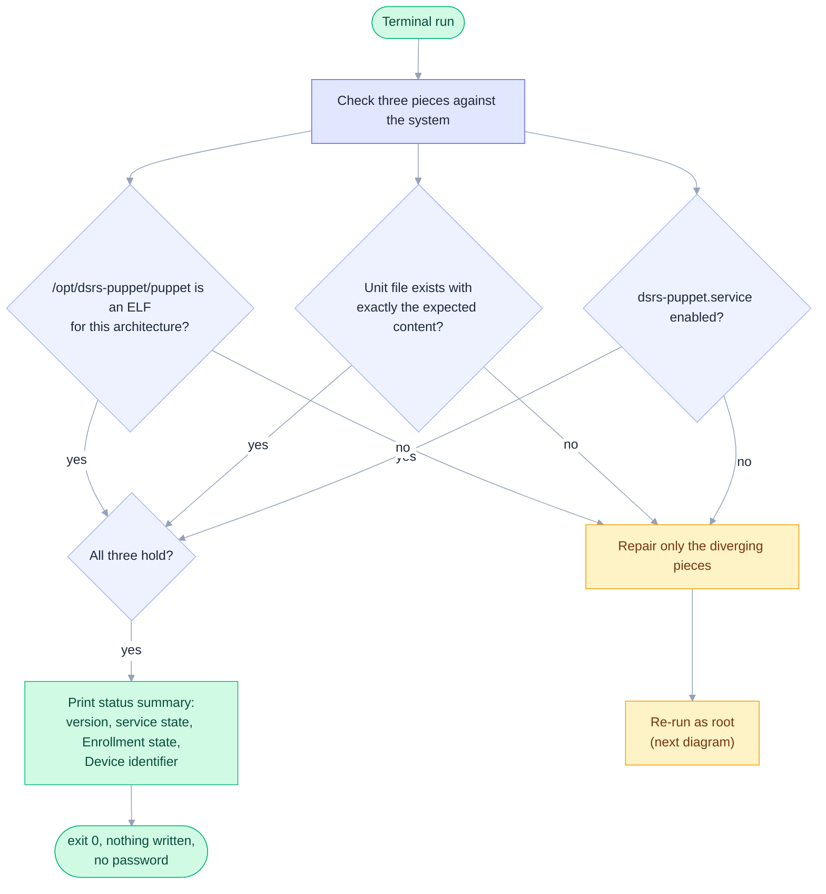
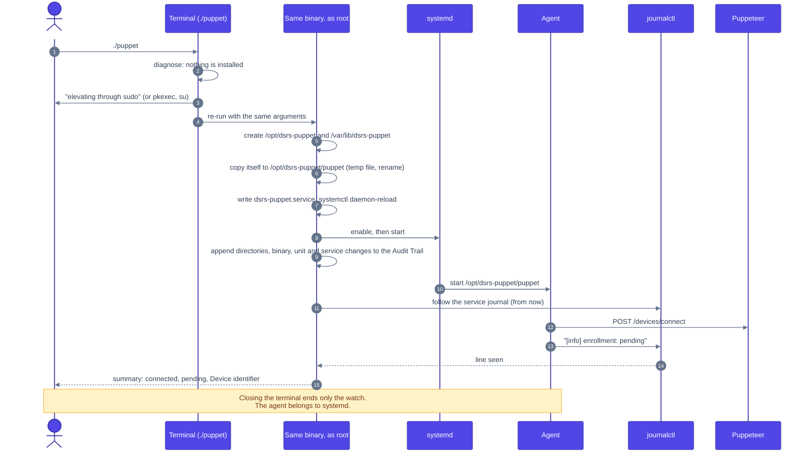
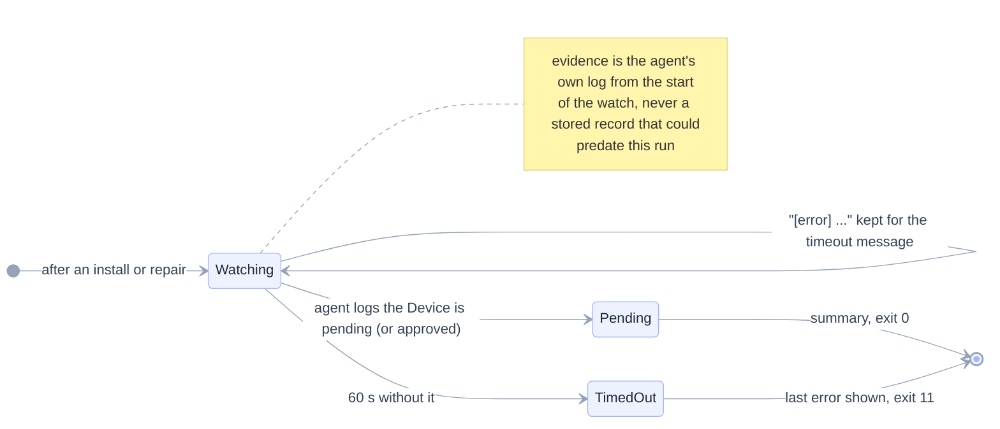
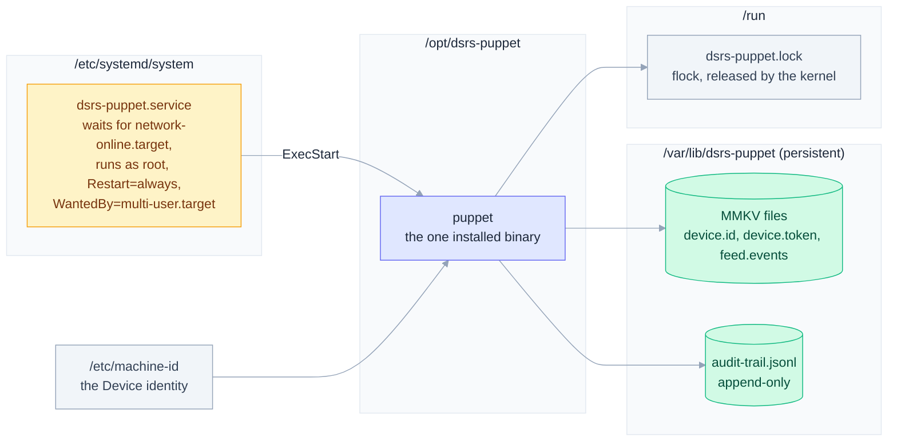
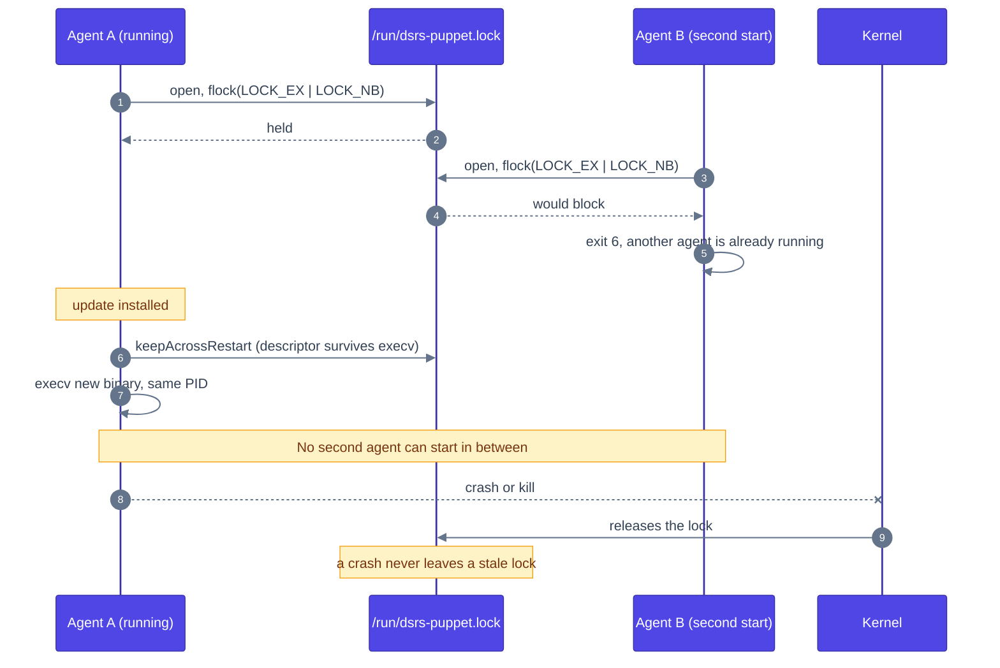
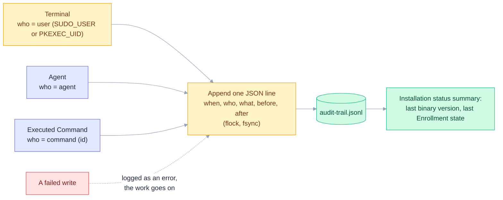

# Installation

How a technician puts the Puppet on a Device with one binary and one command, how it repairs itself, and the files it leaves behind. The decision is in [ADR-0001](adr/0001-self-installing-binary-configured-at-compile-time.md); the step-by-step is in the [README](../README.md#running-the-application-the-installation).

## Contents

- [Two roles, one binary](#two-roles-one-binary)
- [What is checked](#what-is-checked)
- [Elevation and repair](#elevation-and-repair)
- [A fresh Installation](#a-fresh-installation)
- [Watching the agent](#watching-the-agent)
- [Where things live](#where-things-live)
- [Only one agent](#only-one-agent)
- [Device Audit Trail](#device-audit-trail)

## Two roles, one binary

Which role a process plays is decided from how it was started, never from a flag. The only environment variables the Puppet reads say who started it: `INVOCATION_ID` (systemd) and `SUDO_USER`/`PKEXEC_UID` (the technician).


## What is checked

Whether the Puppet is installed is never stored. Every run compares three pieces with the system, so a flag can never disagree with reality. A valid installed binary is never replaced by a terminal run, even when it differs from the one running: only self-update changes it, so an old copy on a USB stick cannot downgrade a Device.



## Elevation and repair

The password is always typed by a person, never embedded in the binary. Each way is announced on the terminal before it asks for anything. `sudo` is tried first because only it knows (a group, or a sudoers entry) whether your user may; `pkexec` lets a user without sudo rights authenticate as an administrator; `su` is the last resort and needs the root password, so it fails where Debian locked root.


## A fresh Installation



## Watching the agent

After a repair or install the terminal stays on as a read-only observer so the technician sees on site whether the Device works. It never takes the agent lock and never opens the agent's storage.



## Where things live

Every name visible to the operating system carries the `dsrs-` prefix, so it never collides with Debian's `puppet` package. The data directory must be on persistent storage: losing it makes the Device enroll again as a new pending Device.



## Only one agent

The kernel releases the lock when the process dies, and the descriptor survives the self-update `execv`, so the restart is never raced.



## Device Audit Trail

Every change the Puppet makes to the Device is appended to `/var/lib/dsrs-puppet/audit-trail.jsonl`. The file is only ever appended to, concurrent writers produce separate intact lines, and resuming stored credentials is not an Enrollment change, so a restart records nothing by itself.



```json
{"when":"2026-01-02T03:04:05Z","who":{"kind":"command","identifier":"<command id>"},"what":"binary","before":"0.0.1","after":"0.0.2 sha256:<hex>"}
```
