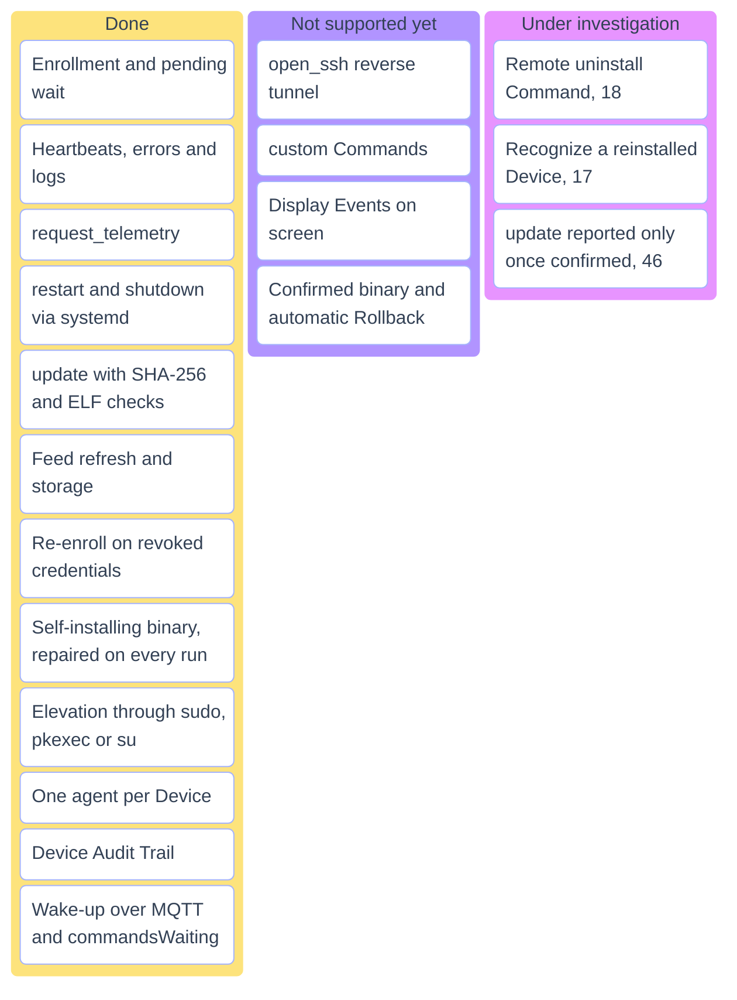
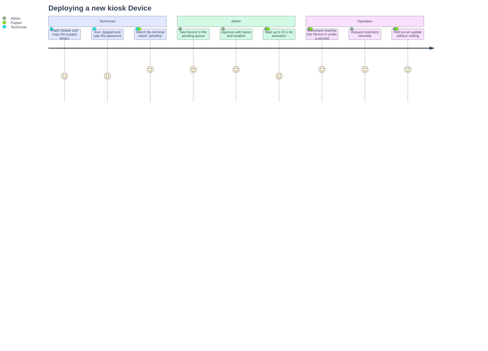
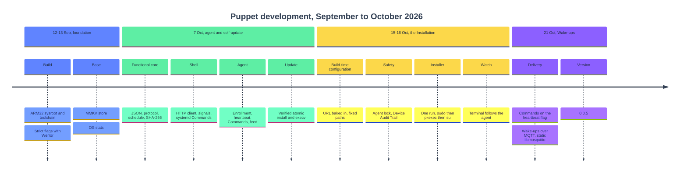

# Project status

Traceability to issue #1 and the ADRs, feature status, how a Device is rolled out, and how the Puppet came to be.

## Contents

- [Requirements traceability](#requirements-traceability)
- [Feature status](#feature-status)
- [Deploying a kiosk](#deploying-a-kiosk)
- [Development timeline](#development-timeline)

## Requirements traceability

Puppet user stories 31–36 from issue #1, the two decisions that shaped the rest, and the modules that satisfy them.

```mermaid
%%{init: {'theme': 'base', 'themeVariables': {
  'primaryColor': '#e0e7ff', 'primaryTextColor': '#1e293b',
  'primaryBorderColor': '#6366f1', 'lineColor': '#94a3b8',
  'secondaryColor': '#d1fae5', 'tertiaryColor': '#fef3c7',
  'background': '#ffffff', 'mainBkg': '#eef2ff', 'nodeBorder': '#a5b4fc',
  'clusterBkg': '#f8fafc', 'clusterBorder': '#e2e8f0',
  'titleColor': '#1e293b', 'edgeLabelBackground': '#ffffff', 'textColor': '#334155'
}}}%%
requirementDiagram
    functionalRequirement story31 {
        id: "US-31"
        text: "Connect and wait in pending state"
        risk: medium
        verifymethod: test
    }
    functionalRequirement story32 {
        id: "US-32"
        text: "Receive the event feed after approval"
        risk: low
        verifymethod: test
    }
    functionalRequirement story33 {
        id: "US-33"
        text: "Send heartbeats, errors and logs"
        risk: low
        verifymethod: demonstration
    }
    functionalRequirement story34 {
        id: "US-34"
        text: "Answer telemetry requests"
        risk: low
        verifymethod: demonstration
    }
    functionalRequirement story35 {
        id: "US-35"
        text: "Execute restart, shutdown and update"
        risk: high
        verifymethod: demonstration
    }
    functionalRequirement story36 {
        id: "US-36"
        text: "Tolerate not yet approved without crashing"
        risk: medium
        verifymethod: test
    }
    functionalRequirement installation {
        id: "ADR-0001"
        text: "Install and repair itself from one binary"
        risk: high
        verifymethod: test
    }
    functionalRequirement wakeup {
        id: "ADR-0001 (monorepo)"
        text: "Receive Commands within a second"
        risk: medium
        verifymethod: demonstration
    }
    element agentSchedule {
        type: module
        docref: "src/agent/agent-schedule.h"
    }
    element agentLoop {
        type: module
        docref: "src/agent/agent.h"
    }
    element selfUpdate {
        type: module
        docref: "src/update/self-update.h"
    }
    element installer {
        type: module
        docref: "src/installer/installer.h"
    }
    element wakeupListener {
        type: module
        docref: "src/wakeup/wakeup.h"
    }
    agentSchedule - satisfies -> story31
    agentSchedule - satisfies -> story36
    agentLoop - satisfies -> story32
    agentLoop - satisfies -> story33
    agentLoop - satisfies -> story34
    selfUpdate - satisfies -> story35
    installer - satisfies -> installation
    wakeupListener - satisfies -> wakeup
```

## Feature status

What is done, what is not supported yet, and what is still being investigated. The numbers are GitHub issues.

## Deploying a kiosk

From copying the binary to rolling out updates remotely.

## Development timeline

Order in which the pieces were built, from the git history.

