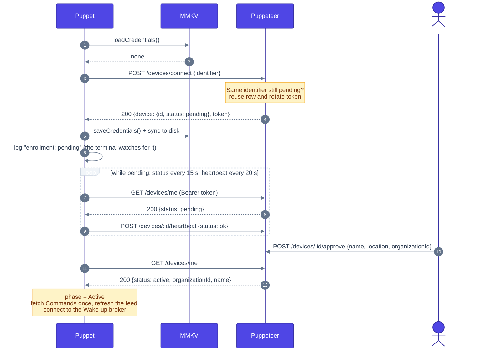
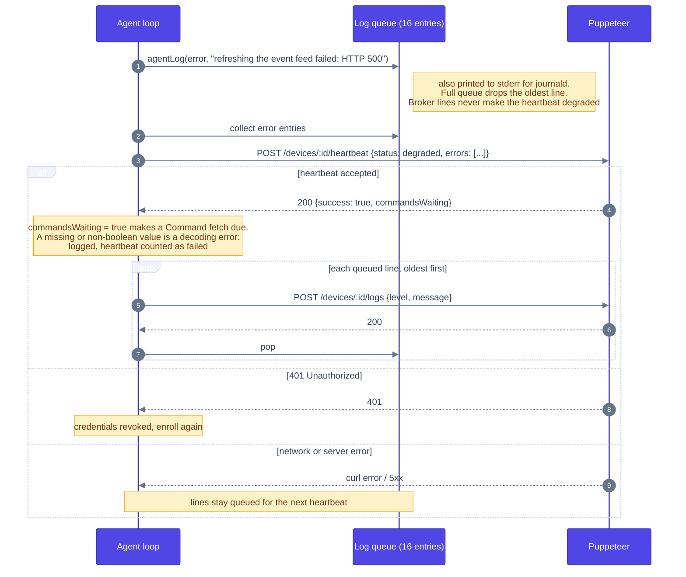
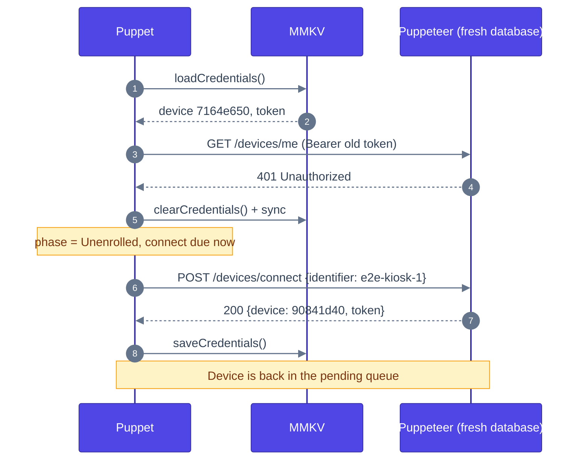
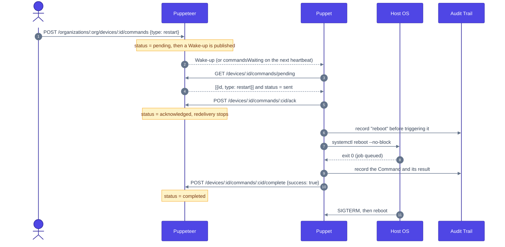
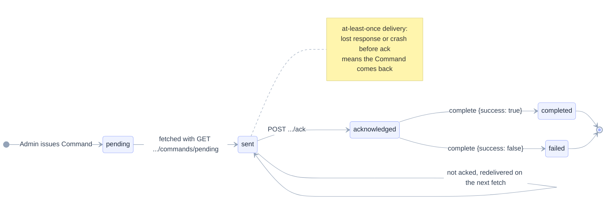
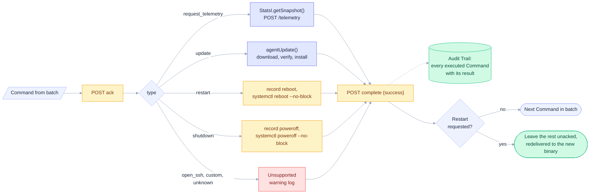
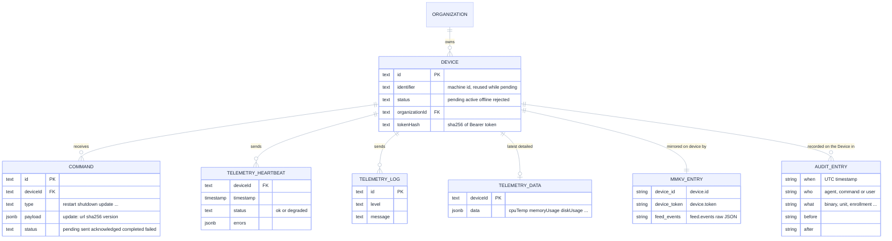
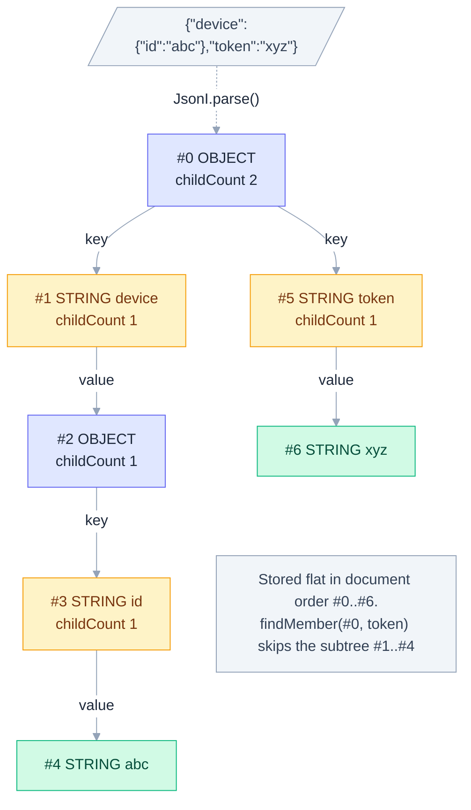

# Device protocol

Every exchange between Puppet and Puppeteer. Request bodies and responses are encoded and decoded by the pure `protocol` module on top of the allocation-free `json` module. Commands are announced by a [Wake-up](wakeup.md) and fetched over this protocol.

## Contents

- [Enrollment](#enrollment)
- [Heartbeat and logs](#heartbeat-and-logs)
- [Revoked credentials](#revoked-credentials)
- [Command lifecycle](#command-lifecycle)
- [Command status on Puppeteer](#command-status-on-puppeteer)
- [Command dispatch](#command-dispatch)
- [Data model](#data-model)
- [JSON token layout](#json-token-layout)

## Enrollment

Zero-touch: the Puppet announces itself and waits. It sends no Organization, so every Device appears in the Superadmin's pending queue. A Device that reconnects with the same identifier while still pending reuses its row.

## Heartbeat and logs

Errors since the last heartbeat travel inside it; every log line is then shipped through the logs endpoint. The answer also says whether Commands are waiting.

## Revoked credentials

Recorded during end-to-end testing against a Puppeteer restarted with an empty database.

## Command lifecycle

The Puppet acknowledges a Command before executing it and reports the outcome afterwards. Today `update` is reported as succeeded as soon as the new binary is installed, before it restarts into it (issue #46 proposes reporting it only once the new binary is confirmed).

## Command status on Puppeteer

Delivery is at-least-once: anything not acknowledged is returned again by the next fetch.

## Command dispatch

How each Command type is handled. Unsupported types are reported as failed with a warning log.

## Data model

Server-side records touched by the device protocol, and what the Puppet keeps locally: the MMKV entries and the Audit Trail.

## JSON token layout

The tokenizer writes a flat array of tokens in document order. Objects count their keys, each key has its value as single child, and lookups skip whole subtrees.

