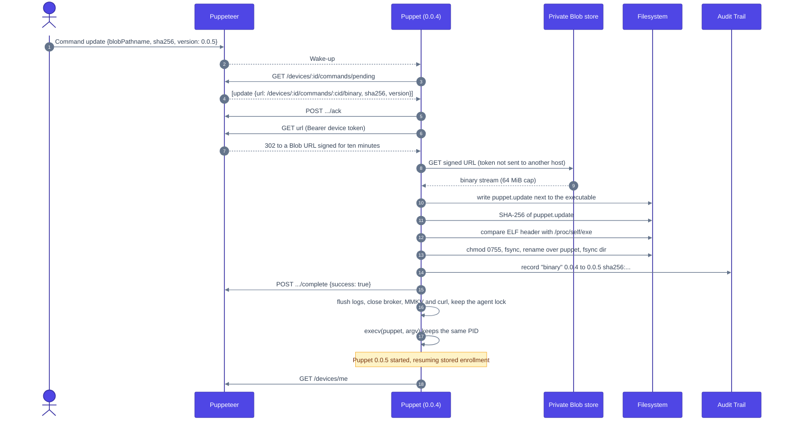
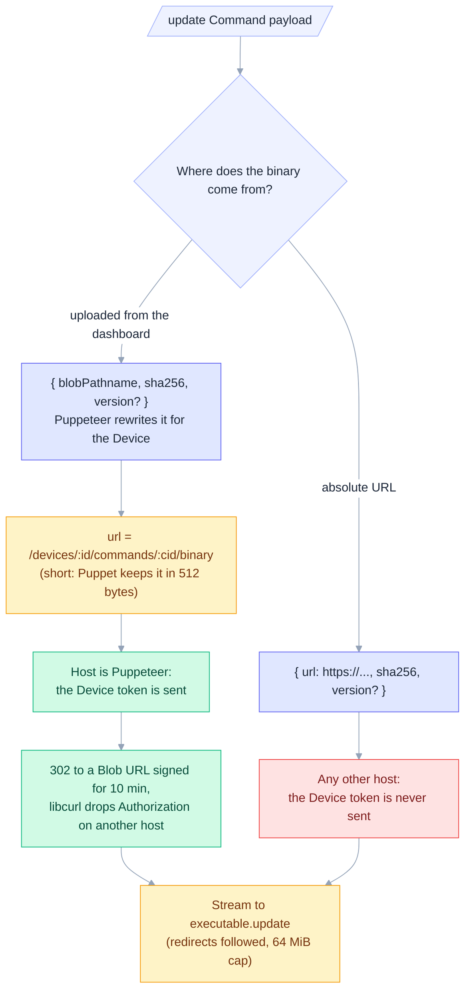
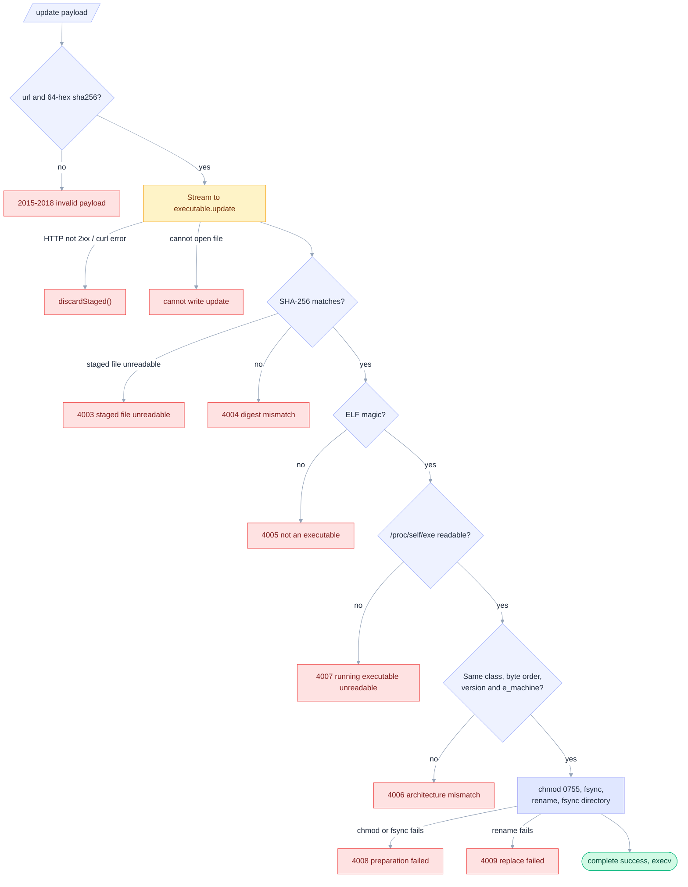
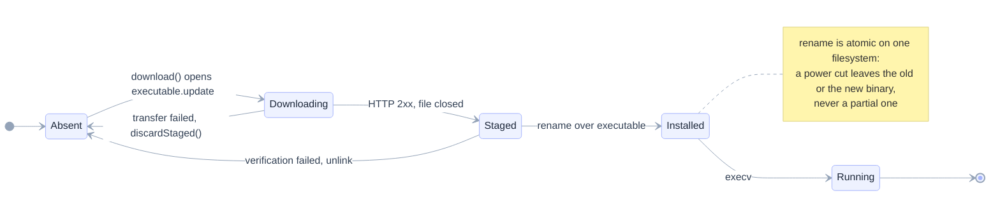
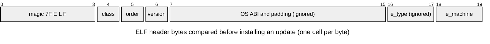
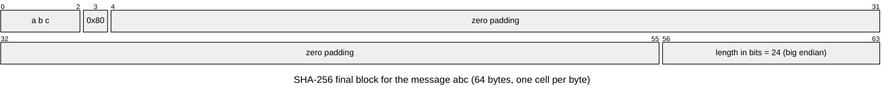
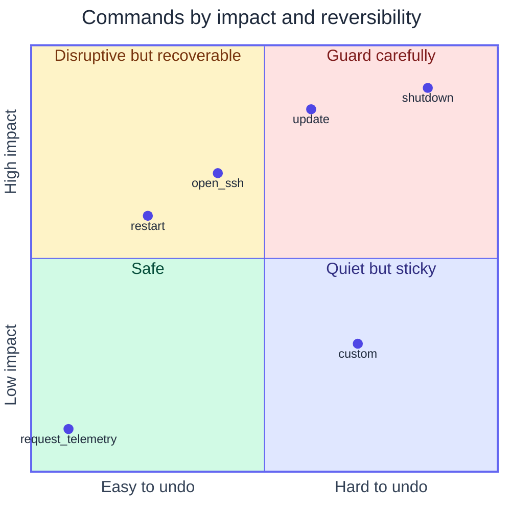
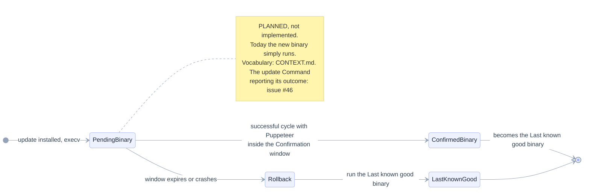

# Self-update

The `update` Command replaces the Puppet binary in place. Payload: `{"url": "...", "sha256": "<64 hex>", "version": "..."}`. When an admin uploads the binary from the dashboard, the `url` is a short path on Puppeteer (a signed Blob URL does not fit the 512-byte address buffer). Puppet sends its device token there and Puppeteer answers 302 to a Blob URL signed for ten minutes; libcurl drops the `Authorization` header when following a redirect to another host.

The Installation never replaces a valid installed binary: **only self-update changes it**, so every binary a Device runs got there through a verified `update` (or the first Installation), and the Audit Trail's latest `binary` entry always describes what is installed.

## Contents

- [End to end](#end-to-end)
- [Where the binary comes from](#where-the-binary-comes-from)
- [Verification](#verification)
- [Staged file lifecycle](#staged-file-lifecycle)
- [ELF header check](#elf-header-check)
- [SHA-256 padding](#sha-256-padding)
- [Command risk](#command-risk)
- [Planned: confirmation and Rollback](#planned-confirmation-and-rollback)

## End to end

The process keeps its PID: `execv` replaces the image, and the new binary resumes the stored enrollment. The agent lock survives the `execv`, so no second agent can start in between. Commands left in the same batch are redelivered to the new binary.

## Where the binary comes from

## Verification

Nothing is installed unless the digest matches and the ELF header targets the running architecture. Each rejection has its own code.

## Staged file lifecycle

The download lives next to the executable so the final `rename` is atomic.

## ELF header check

The first 20 bytes compared between the download and `/proc/self/exe`. `e_type` is ignored because PIE and non-PIE builds differ there.

## SHA-256 padding

The in-house SHA-256 (FIPS 180-4) pads the message as shown for `abc`. It is verified against NIST test vectors.

## Command risk

Why update and shutdown get the most safeguards. The positions are a judgment, not a measurement.

## Planned: confirmation and Rollback

A bad update cannot be undone today: the new binary replaces the old one and runs. The agreed vocabulary for an automatic Rollback (Confirmed binary, Last known good binary, Pending binary, Confirmation window) is in [CONTEXT.md](../CONTEXT.md); none of it is implemented yet.

