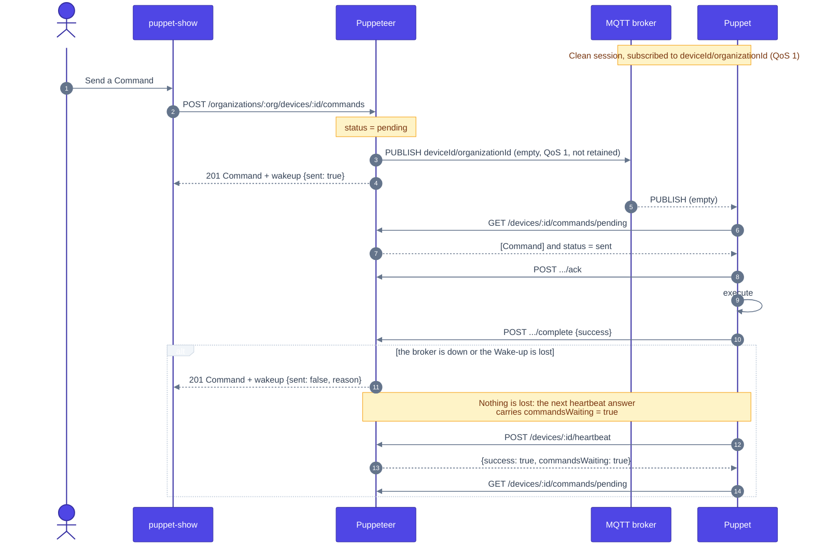
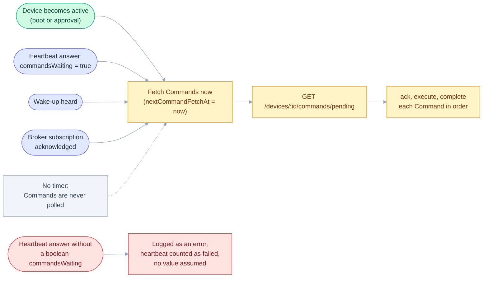
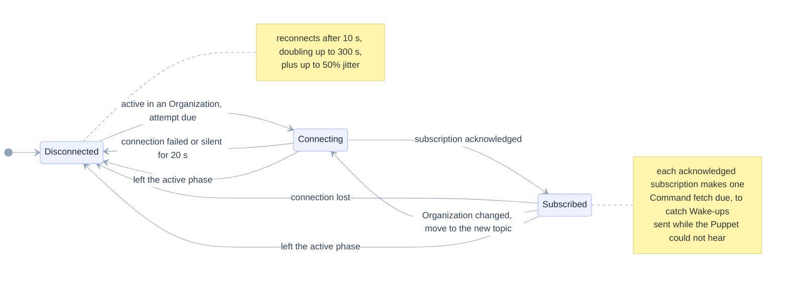
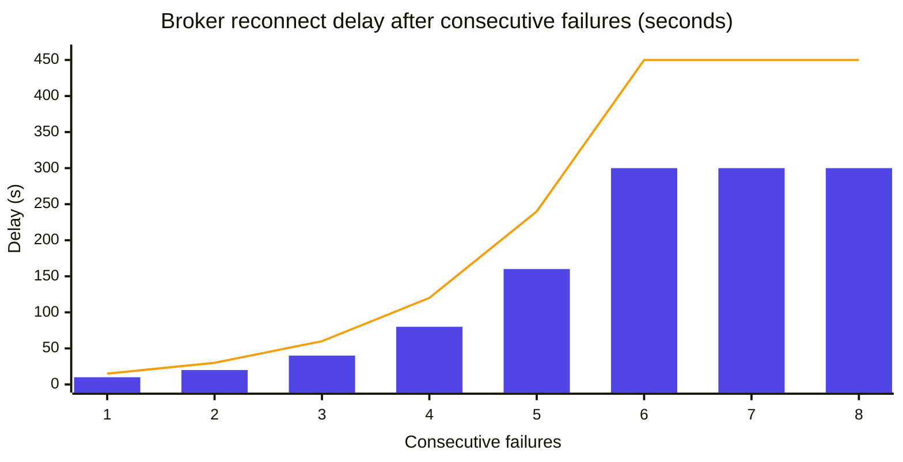
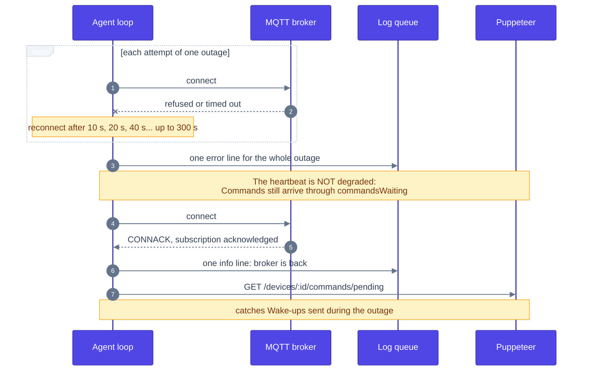

# Wake-ups

How a Command reaches a Puppet in well under a second, and what happens when the shortcut breaks. The decision is recorded in the monorepo's [ADR-0001](../../../docs/adr/0001-wake-up-over-public-mqtt-broker.md).

## Contents

- [Delivery](#delivery)
- [When Commands are fetched](#when-commands-are-fetched)
- [Broker connection](#broker-connection)
- [Reconnect backoff](#reconnect-backoff)
- [Outages](#outages)
- [Settings and trust](#settings-and-trust)

## Delivery

When Puppeteer stores a Command it publishes an empty **Wake-up** on a public MQTT broker, topic `<deviceId>/<organizationId>`. The Puppet is subscribed to it and fetches its Commands as soon as it hears one. The broker is only an accelerator: the heartbeat answer says whether Commands are waiting, so a missed Wake-up costs at most one heartbeat (20 s).

## When Commands are fetched

Commands are never fetched on a timer. These are the only triggers, all of which make a fetch due at once:

## Broker connection

The schedule tracks how far the connection has come. It never marks the Device unhealthy because of the broker; it only retries.

## Reconnect backoff

Reconnection starts at 10 s and doubles to a 300 s cap. Up to 50% of random jitter is added so a fleet does not reconnect in lockstep after a broker outage.

## Outages

However many attempts an outage takes, the Puppet writes one error line when it starts and one info line when the broker is back. Admins read both in the Device's logs.

## Settings and trust

- Host, port and TLS are compile-time constants: CMake options `PUPPET_WAKEUP_BROKER_HOST` (default `broker.hivemq.com`), `PUPPET_WAKEUP_BROKER_PORT` (`8883`) and `PUPPET_WAKEUP_BROKER_TLS` (`ON`). With TLS on, the broker's certificate is verified against the system store.
- Puppeteer publishes to a fixed broker (`WAKEUP_BROKER_URL` in `apps/puppeteer/src/io/wakeup/mqtt.ts`), so a build that changes these options must change it too, or the Puppet never hears a Wake-up and falls back to the heartbeat.
- The topic is not secret: anyone who learns it can see when a Device is woken up or send it a fake Wake-up. The worst case is one extra authenticated fetch, because the Wake-up carries nothing and Commands are fetched over HTTPS with the Device token.
- libmosquitto (v2.0.11) is linked statically, so a Device needs no MQTT library and a Puppet that updates itself never depends on one the Device may lack. The loop is single-threaded: the library's network loop is driven from outside, and the one blocking moment is the hostname lookup when a connection starts.
